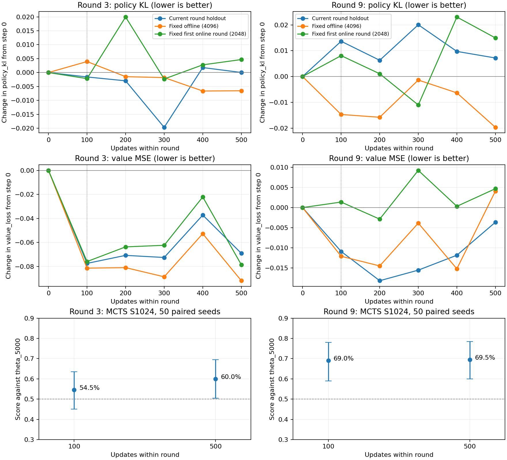

# 第3、9轮：100步与500步对比

2026-10-05。对象为 `runs/entity_attention_hybrid_static_graph_seed1`，轮号采用人类编号：第3轮对应 `round-002`，第9轮对应 `round-008`。先选早期已有评测的第3轮、最近已有评测的第9轮，再测100步，未按结果挑选轮次。

结论：后400步的收益不稳定，第9轮未观察到明显的额外MCTS收益；同时，没有证据表明500步导致明显棋力回退或整池数据被反复过度训练。若目标是更快刷新采集模型，值得试更小采集轮配合100步更新，先保持训练/采集比；不建议仅因这两轮检查点相近就直接把每1000局训练500步长期降到100步。

| 轮次 | 100步胜/负/和 | 100步得分 | 500步胜/负/和 | 500步得分 | 500−100 | 差值95%配对区间 |
|---|---|---:|---|---:|---:|---:|
| 3 | 54/45/1 | 54.5% | 59/39/2 | 60.0% | +5.5个百分点 | −8.5至+19.5个百分点 |
| 9 | 69/31/0 | 69.0% | 69/30/1 | 69.5% | +0.5个百分点 | −10.5至+11.0个百分点 |

四份面板均为100/100有效对局，无异常、非法行动、不变量失败、工程截断或强制跳过。第3轮500步表现较好，但区间不排除100步较好；第9轮点估计非常接近，区间仍不足以证明等价。换座pair上第3轮500步较好/相同/100步较好为19/17/14，第9轮为14/25/11。新增两份100步评测分别347.37和325.24秒，总计11.21分钟；500步使用原有效结果，没有重跑。

两轮都复用此前正式run的500步有效评测，补测100步。双方都是 attention MCTS，S1024/N1、无root noise、native_batched compiled FP32、active_games=100、max_batch_size=64；共同对手是离线5000步起点。同一50组游戏种子 `14700000…14700049` 各换座两局，共100局/检查点；policy_seed_base=14710000，search seed=14730000，bootstrap seed=14720000，重采样10000次。每轮两个配置只更改候选checkpoint，累计步数分别为6100/6500与9100/9500。得分为胜=1、和=0.5、负=0；这是对共同对手的表现差，不是100步与500步直接互打。

以下验证集均按整局与训练隔离。current为当轮全部留出局面，第3轮9023个、第9轮8444个；offline_fixed沿用4096个固定离线局面；online_fixed沿用第一轮2048个固定在线局面，不代表最新分布。CPU FP32、单线程、batch256重新计算0/100/200/300/400/500步，未执行优化器更新；0/500端点与原CUDA诊断的policy KL、value MSE差均小于1e-5。policy KL只计有policy权重的局面，各集合计数见原始JSON，不把强制行动当作policy监督。

| 轮次 | 验证集 | policy KL：100→500 | value MSE：100→500 |
|---|---|---:|---:|
| 3 | 当轮留出 | 0.49670→0.49831 | 0.74668→0.75507 |
| 3 | 固定离线 | 0.62906→0.61857 | 0.77122→0.76076 |
| 3 | 固定在线 | 0.35328→0.36013 | 0.72467→0.72204 |
| 9 | 当轮留出 | 0.48337→0.47689 | 0.79235→0.79962 |
| 9 | 固定离线 | 0.63085→0.62585 | 0.75168→0.76789 |
| 9 | 固定在线 | 0.36638→0.37325 | 0.73077→0.73410 |

两项误差越低越好。第3轮后400步改善固定离线数据，固定在线value收益只有0.00263，当轮value反而回升0.00838。第9轮后400步改善部分policy拟合，但三个验证集的value MSE均回升。它们不支持“100—500步匀速改善”，也不能单靠损失判定MCTS棋力，特别是固定旧分布误差与当前对战不是同一目标。

把前100步与最后100步分开看，更能看出收益不均匀。下表是误差下降量，即前一个检查点误差减去后一个检查点误差；负数代表回退。

| 轮次 | 当轮留出指标 | 0→100步 | 400→500步 |
|---|---|---:|---:|
| 3 | policy KL下降 | +0.00159 | +0.00177 |
| 3 | value MSE下降 | +0.07738 | +0.03178 |
| 9 | policy KL下降 | −0.01366 | +0.00255 |
| 9 | value MSE下降 | +0.01090 | −0.00821 |

第3轮value在400步先回退，500步的“进步”包含恢复此前损失；第一轮固定在线验证上的第3轮value在100步已取得其0→500步净下降的约96.7%。第9轮当轮value在200步更低、500步回退。完整曲线见 `validation_curves.json`，不要将某两个区间的改善外推为恒定学习速度。本次MCTS只比较100和500步，没有测本轮0、400步对战，不能计算0→100与400→500的实际棋力增长速度。

训练日志采用各项原始加权和汇总，每100步一段，policy KL扣除目标熵；不将不同监督权重的batch KL直接平均。训练数据是固定配额混合，故这些是混合训练误差，不能当作当轮留出误差。

| 轮次 | 指标 | 第1—100步均值 | 第401—500步均值 |
|---|---|---:|---:|
| 3 | 混合训练policy KL | 0.55698 | 0.55850 |
| 3 | 混合训练value MSE | 0.78880 | 0.78569 |
| 3 | batch total loss均值 | 2.81606 | 2.80853 |
| 9 | 混合训练policy KL | 0.49549 | 0.48704 |
| 9 | 混合训练value MSE | 0.80071 | 0.79714 |
| 9 | batch total loss均值 | 2.79069 | 2.78590 |

训练误差下降有限且各段有波动。两轮500步全部触发clip1，100步分段的裁剪前梯度范数均值约6.56—10.02，训练未出现非有限值。日志没有policy/value分别对共享trunk的梯度夹角，因此不能据这些指标证明value梯度破坏policy，也不能证明二者完全没有冲突。

采样数量来自原始二进制reference账本，按轮内步数去重恢复，不把日志中的 `current_positions` 误当作当轮新数据：在此混合入口中它表示整个online池的batch配额，含历史在线局面。batch256，第3轮离线/在线=160/96，第9轮=64/192；因此100步合计25600次采样，500步128000次。online池分别235137与461221个训练局面，后者保留最近6000局。

| 轮次 | 更新步数 | online总采样次数 | 其中当轮新数据次数 | 当轮独立局面数 | 当轮训练局面覆盖率 |
|---|---:|---:|---:|---:|---:|
| 3 | 100 | 9600 | 3289 | 3218 | 4.07% |
| 3 | 500 | 48000 | 16115 | 14587 | 18.47% |
| 9 | 100 | 19200 | 3333 | 3268 | 4.24% |
| 9 | 500 | 96000 | 16248 | 14603 | 18.93% |

500步online平均曝光量仅0.204/0.208次，100步为0.041/0.042次；500步的重复采样占比约9.5%/9.8%，100步约2.1%/2.2%。第3/9轮500步离线平均曝光量为0.104/0.042次。它们不符合“整池反复刷很多遍”的情形。数据仍可在后续轮被抽到，局面之间也有相关性，所以覆盖率不是学习充分性的直接证明；但直接把同一1000局的更新从500降为100会显著减少昂贵新数据的使用。

原始训练日志的耗时如下，采样/组批/更新阶段会同步读回loss，但不含保存checkpoint、reference/metrics写盘、轮前轮后验证以及棋力评测；不把它们冒充整轮learner完整墙钟。首次缓存载入和恢复后的冷载入会影响这些数值，详见所有9轮统计。

| 轮次 | 1000局采集 | 500步采样+组批+更新 | 其中后400步 |
|---|---:|---:|---:|
| 3 | 1739.32秒（28.99分钟） | 13.88秒 | 8.21秒 |
| 9 | 1702.76秒（28.38分钟） | 14.44秒 | 8.97秒 |

删去后400步在这两轮只省约8—9秒的上述训练阶段，约为采集时间的0.5%。若目标是更频繁更新采集模型，应该考虑同时缩小每轮采集量；例如200局+100步保持原来1000局+500步的更新/新局数比，作为下一项待验证方案。在线池保留游戏数可继续6000；离线混合日程应按累计采集游戏数换算，不能直接按更多的小轮数提前切到纯在线。小规模采集的并发吞吐未测，耗时不保证同比缩短。本次没有执行这种新训练方案。

本次比较发生在既有训练轨迹内：第9轮的100步checkpoint仍继承前8轮各500步训练。它不能证明从第一轮起长期每轮100步会达到同样水平。50个paired seeds的区间也不足以证明两检查点等价。单训练seed、共同对手、相同已使用面板不能代替多seed或独立保留测试集。这些结果支持把“200局+100步、按累计采集量推进配额”作为下一项对照候选；不支持把“100步已足够”或“500步过拟合导致下降”当作已证明结论，也没有必要因此增加胜率拒绝更新机制。



图中上两行显示相对本轮0步的policy KL、value MSE变化，低于零代表改善；下行是对固定起点的MCTS得分及95%配对bootstrap区间，不能用两条区间是否重叠替代上表中直接计算的配对差值区间。

`manifest.json`保存冻结训练配置、代码身份、原始输入路径与哈希、评测命令；`configs/`保存四个评测配置，`round*_step*.json`保留完整逐pair原始汇总；`training_analysis.json`包含所有9轮的训练分段、采样覆盖和采集统计；`validation_curves.json`包含两轮六个检查点的三套验证结果；`strength_comparison.json`记录500减100的配对bootstrap差。重型对局日志、资源逐点日志和源码快照在被忽略的 `runtime/entity_attention_100_vs_500_20261005/`，既有500步对局日志仍在原run中。100步评测的独立代码/环境身份另保存在 `recording/`；既有500步评测未记录同等独立会话身份，不用当前代码版本补填这一缺失。

模型推理、评测和统计均在conda `splendor` 中执行。本机该环境没有Matplotlib，绘图入口单独调用已有 `base` 环境中的Matplotlib 3.10.6，只读取已完成的JSON，不执行模型推理；环境与绘图脚本身份记录在manifest。未安装依赖或修改训练环境。

从仓库根目录复核CPU统计与图表：

```bash
conda run --no-capture-output -n splendor env PYTHONPATH=src python -u artifacts/entity_attention_100_vs_500_20261005/analyze.py training
conda run --no-capture-output -n splendor env PYTHONPATH=src python -u artifacts/entity_attention_100_vs_500_20261005/analyze.py validation
conda run --no-capture-output -n splendor env PYTHONPATH=src python -u artifacts/entity_attention_100_vs_500_20261005/analyze.py finalize
conda run --no-capture-output -n splendor env PYTHONPATH=src python -u artifacts/entity_attention_100_vs_500_20261005/analyze.py plot
```

GPU评测的原始命令见manifest；已有输出复用时加 `--resume`，不要删除原始sidecar。更换面板或配置应另选输出路径。运行需要本机原checkpoint和训练NPZ，重型文件未纳入本交付目录。

总览中“前三轮已训练、尚无有效棋力结果/正式训练未启动”的旧描述需后续同步：涉及 `docs/guides/entity_attention_hybrid_zh-CN.md` 首段、README混合训练入口、`docs/current_project_state_zh-CN.md` 对应状态行以及 `docs/index.md` 对应入口。替代依据是原run第3/6/9轮的有效500步评测，以及本目录完成的检查点对比。本次分析保留这些既有文档内容，不将分析扩展为项目文档修改。
