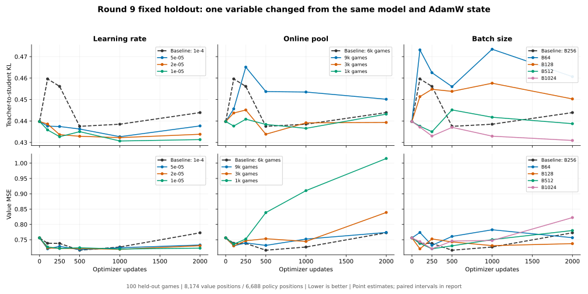

# 第九轮单变量实验：完成结论

2026-10-10，10/10个新分支全部完成。共同起点为第八轮结束模型38,398步；原配置基准为lr1e-4、6k在线池、B256。新分支各训练2000步，记录100／250／500／1000／2000步，B1024另存125步；原配置0–5000步直接复用已有checkpoint并统一重算。完整数字与整局配对区间见[自动结果表](results.md)、[机器汇总](summary.json)。

五个指定步数的全部11组配置，另集中整理为[留出／Train四张完整矩阵](steps_100_2000.md)及[完整精度JSON](steps_100_2000.json)，共55个唯一配置—节点，原配置的重复评测合并计数。

2026-10-11后续补测：lr2e-5×1000步与原lr1e-4×500步做[新开局200 pair直接S1024/N1对战](../entity_attention_r9_lr_step_arena_20261011/results.md)，前者212胜／2和／186负，得分53.250%，95% CI [48.500%, 58.000%]。这是未确认的正面点估计，尚未证明棋力优势；同时改变了lr和步数，不能拆成单独的学习率贡献。以下拟合结果仍对应2026-10-10的固定数据实验。



图中为点估计，各列只改变一个变量，横轴为更新步数；图不显示逐点置信区间，判断差异应参照结果表与summary。value轴共用量程，保留1k池明显变差的完整幅度。

## 100／250步没有比500步更好

| 原配置步数 | 留出KL | 留出MSE | 最新代固定Train KL | 最新代固定Train MSE |
| ---: | ---: | ---: | ---: | ---: |
| 0 | 0.439744 | 0.756041 | 0.442498 | 0.743491 |
| 100 | 0.459619 | 0.738431 | 0.462918 | 0.710739 |
| 250 | 0.456135 | 0.738025 | 0.460981 | 0.712904 |
| 500 | 0.437501 | 0.715736 | 0.443046 | 0.695027 |
| 1000 | 0.438483 | 0.726227 | 0.442314 | 0.667266 |
| 2000 | 0.443908 | 0.772683 | 0.447373 | 0.623796 |
| 5000 | 0.436822 | 0.829076 | 0.433650 | 0.508035 |

100、250步相对500步的KL增量分别为+0.022118、+0.018633，95% CI为[+0.017588,+0.026614]、[+0.014467,+0.023019]。MSE的点估计也更差，但差值区间均跨0，不能说两项都已确认退化。

早期policy回退同时出现在最新代Train与Validation，不能只解释为“训练拟合很好但不能泛化”；对最新代这个固定子集，短训本身就在偏离教师。相反，value在500→5000步呈现明确的训练—留出分化：Train MSE从0.695027下降至0.508035，Validation MSE从0.715736升至0.829076。两类现象应分别讨论，不能统称为欠拟合或过拟合。

这仍不证明500步是最优：没有覆盖所有中间节点，也未复验采样／训练seed，且改学习率后曲线会改变。

## 较小学习率是本次更有价值的policy信号

在相同500步、相同6k窗口、相同B256下：

| 学习率 | 留出KL | 留出MSE | 相对1e-4的ΔKL 95% CI |
| --- | ---: | ---: | --- |
| 1e-4 | 0.437501 | 0.715736 | — |
| 5e-5 | 0.436241 | 0.717465 | [-0.003056,+0.000572] |
| 2e-5 | 0.432872 | 0.721102 | [-0.006675,-0.002565] |
| 1e-5 | 0.435023 | 0.723806 | [-0.004712,-0.000266] |

2e-5与1e-5的policy KL改善获得逐点区间支持；5e-5的500步改善未得到明确支持。三档较小lr的500步MSE与基准差值区间都跨0，不能宣称value已经改善，也不能把跨0视为严格等效。

三档较小lr均减轻了原配置100／250步时的policy回退；到1000步，1e-5的KL为0.430668、MSE为0.719699，2e-5为0.432231／0.718900。这些曲线表明“步数更少总更好”不成立，步长与停止点需联合考虑。直接拿这些1000步点对比原500步，会同时改变lr和步数；单变量证据应优先看相同步数比较。

所有lr分支保留了第八轮的AdamW动量，并且实际抽样序列与原配置前2000步逐条一致，因此观察到的差异不是换了一批训练样本。测到的是继承AdamW状态后的续训学习率效果，不能直接推广到重置优化器或全新初始化。

## 在线池存在新数据拟合与泛化的取舍

| 池大小 | 代际 | 实际Train局数 | Train局面数 | 最新代期望抽样占比 | 500步KL | 500步MSE |
| ---: | --- | ---: | ---: | ---: | ---: | ---: |
| 9k | 第1–9轮 | 8054 | 654945 | 11.13% | 0.453711 | 0.731546 |
| 6k基准 | 第4–9轮 | 5383 | 436458 | 16.71% | 0.437501 | 0.715736 |
| 3k | 第7–9轮 | 2681 | 216778 | 33.64% | 0.433820 | 0.753285 |
| 1k | 仅第9轮 | 900 | 72915 | 100% | 0.438389 | 0.838634 |

占比按Train局面均匀抽样计算，不按对局数简单均分。每代1000局中原留出对局始终不进训练，29k旧离线池不参与本次抽样。

9k在500步的KL退化区间为[+0.012580,+0.019828]，MSE差值区间跨0。加入更早的三代并没有改善最新代policy拟合。3k在500步有小幅policy改善信号，但MSE增量区间为[+0.006647,+0.069411]，体现两头的取舍。

1k在500步的KL差值区间跨0，MSE已经明显恶化。到2000步，最新代Train KL／MSE为0.413040／0.254506，留出为0.443188／1.015097；value留出甚至高于同一数据上恒预测0的MSE约0.989356。它能拟合这批Train标签，却没有获得对应的未见对局收益，尤其value过拟合明显。

池大小同时改变历史教师组成、最新代权重、每个局面的重复训练频率；这些是本次池策略的联合效果，不能单独归因为容量或某一代教师质量。

## Batch不能只按相同步数排序

固定500步时，B64／B128两项均比B256差；B512的KL变差，MSE差值区间跨0；B1024的KL差值区间跨0，但MSE增量区间为[+0.004593,+0.054828]。因此没有发现“把batch放大，同时继续500步，两个指标都会更好”。

相同128000条训练抽样的补充比较：

| Batch × 步数 | 留出KL | 留出MSE |
| --- | ---: | ---: |
| 64 × 2000 | 0.460664 | 0.756662 |
| 128 × 1000 | 0.457606 | 0.730740 |
| 256 × 500 | 0.437501 | 0.715736 |
| 512 × 250 | 0.434991 | 0.720356 |
| 1024 × 125 | 0.436246 | 0.727388 |

B512×250相对B256×500的ΔKL为-0.002510，95% CI为[-0.004514,-0.000498]；ΔMSE区间跨0，是小幅policy正面信号。B1024×125两项差值区间都跨0。实际抽样账本证明，这些配置前128000条样本内容及顺序完全一致；改变的是batch分组与更新次数。该口径不是固定步数的单变量比较，应单独解释。

这些结果支持复验较小lr，以及B512配合较少更新次数；不支持直接缩到1k池，也不支持把不同变量各自看起来最好的点直接组合后当成已验证方案。固定500步下，lr2e-5是比较清楚的policy候选，但未证明value或棋力提升。

## 验证与结论边界

[verification.json](verification.json)核对了68个节点、20,000步新增训练与6,528,000条实际抽样引用：所有分支初始权重／AdamW动量／全部RNG相同，学习率分支与原训练样本流一致，batch等抽样量比较的样本流一致，没有留出样本进入训练。所有指标使用共同的100局完整Validation、共同的2048局面Train诊断，按整局分子／分母复算一致。B64未使用的`history_batch_size`配置字段为通过数据类校验限至64，实际历史抽样始终为0；除此之外配置变化与指定实验轴一致。

新增分支的训练、节点评估及训练内汇总合计1061.38秒，约17分41秒。共享缓存最终约1.40GB，资源观察不等于已证明无泄漏。运行时已有搜索对战并发，缓存逐渐热身，所以本实验的时间不是严格的batch吞吐对照，不能用它宣布速度配置最优。

本次只有一个起点、一个采样随机流和固定第九轮DEV；比较多档配置及多个停止点，未作多重比较校正。较小的正面差异应复验，不能把挑出的最低点当成已经确认的最优值。这部分拟合实验自身未包含棋力评测；文首链接记录后续单个候选的直接对战，其他新分支仍未补测。较低KL或MSE不自动等于更强。

复算与绘图：

```bash
conda run --no-capture-output -n splendor env PYTHONPATH=src OMP_NUM_THREADS=1 python artifacts/entity_attention_r9_ofat_20261010/run.py analyze
conda run --no-capture-output -n splendor env PYTHONPATH=src OMP_NUM_THREADS=1 python artifacts/entity_attention_r9_ofat_20261010/verify.py
MPLCONFIGDIR=/tmp/splendor-r9-ofat-mpl python artifacts/entity_attention_r9_ofat_20261010/plot.py
```

绘图命令需使用已安装matplotlib的环境；本次使用系统现有matplotlib环境，没有安装新依赖。原始分支配置、数据引用、源代码身份、运行命令、逐局统计和模型SHA分别保留在plan、execution、fitting与summary中。
