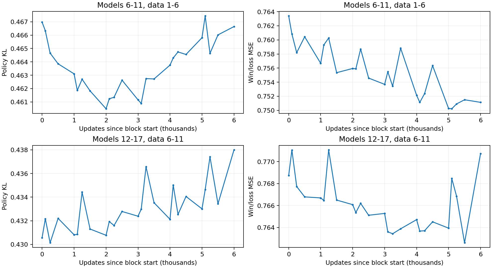

# 六轮固定整局留出回补评估

2026-10-20。只读已有NPZ和checkpoint，未训练、未重新采集或搜索，未新增棋力赛。两组分别使用固定的原始整局validation全量局面。

第6–11轮没有本分支第0轮可用，因此第一组取第1–6轮留出；第6轮数据在第6轮训练0步之前已采集完成，未使用未来数据。第二组严格取第6–11轮留出评估第12–17轮。两组绝对KL/MSE不能直接比较。

每组起点为首轮训练前0步，终点为末轮1000步，共6000次更新；不是首轮1000步到末轮1000步。轮号指37423步起点的新分支，不是原R24–R43。

全部原始留出局按唯一身份去重，并与已保存的17轮Train快照检查无交集；冻结数据SHA、checkpoint SHA、原始标签和权重。使用FP32、关闭TF32，批大小512；state-only value路径和仅正权重policy路径在每组首个模型上与现有联合forward损失实现逐项核对。相同参数的0步／前轮1000步结果复用，但两个数据面板之间不复用。

## 六轮累计变化

| 模型轮次 | 固定数据 | 留出对局 | Policy局面 | Value局面 | KL起点→终点 | MSE起点→终点 | Value相关性起点→终点 |
| --- | --- | ---: | ---: | ---: | --- | --- | --- |
| 6–11 | 1–6 | 2397 | 40057 | 192408 | 0.466969→0.466637 | 0.763401→0.751138 | 0.481162→0.491123 |
| 12–17 | 6–11 | 2406 | 40596 | 193118 | 0.430570→0.437992 | 0.768743→0.770732 | 0.469595→0.473752 |

| 模型轮次 | ΔKL [95%区间] | ΔMSE [95%区间] | Δpolicy首选一致率 [95%区间] |
| --- | --- | --- | --- |
| 6–11 | -0.000331 [-0.001862, +0.001142] | -0.012263 [-0.015837, -0.008925] | -0.062411 [-0.355272, +0.227415] pp |
| 12–17 | +0.007422 [+0.006241, +0.008593] | +0.001989 [-0.001779, +0.005863] | -0.630604 [-0.889217, -0.368338] pp |

区间按整局配对重抽，并在6个数据来源轮次内分层；不是把约19万局面视为独立样本。区间只反映这批对局下的抽样不确定性，不包括不同训练seed或教师的变异。

## 主要发现

1. **第6–11轮：value确有历史留出泛化改善，policy对这批旧标签总体持平。** MSE累计下降0.012263，整局配对区间不跨0；相关性0.4812→0.4911，不能仅解释为缩小预测幅度。KL先在第6–7轮下降，之后逐渐回升，六轮净变化−0.000331，区间跨0。

2. **第12–17轮：最终value MSE未确认改善，policy与旧teacher的分歧增加。** MSE净变化+0.001989，区间跨0；KL增加0.007422，区间全为正，首选一致率61.890%→61.260%。这能确认对同一旧标签的变化，不能单凭它判定当前棋力变弱，或区分遗忘与教师策略更新。

3. **后六轮不是一直没有value收益。** 第12–16轮每轮终点MSE均下降，累计0.768743→0.763936；第17轮500步进一步到0.762603，1000步回升到0.770732。后六轮的最终结果被第17轮末尾波动明显影响。最后500步的MSE增加0.008129，其中平均误差平方增加约0.005861，占约72%；这是MSE=误差方差＋平均误差平方的描述性分解，不是对训练故障的因果定位。

4. **对先前滚动留出的判断作限定。** “后期收益不稳定”仍成立，但不能扩展成“第12轮起value不再学习”。固定大面板显示第12–16轮持续的小幅改善及第17轮明显反复；当前更直接的诊断线索是更新／校准稳定性，还不足以归因于独立对局数不够。EMA、降lr或checkpoint选择是否改善需另做受控验证，本次未实施。

5. **固定历史面板与滚动面板回答不同问题。** 原滚动面板policy KL均值小降，固定旧teacher面板却持平／升高，说明变化不是单一“全局拟合更好”。应同时观察新近标签的吸收与旧分布保持；也不能把两组面板不同造成的绝对差异，当成训练阶段间的强弱差异。

### 第17轮末尾的配对变化

| 比较 | ΔKL [95%区间] | ΔMSE [95%区间] |
| --- | --- | --- |
| 第12轮0步→第16轮1000步 | +0.002437 [+0.001451, +0.003418] | -0.004806 [-0.007797, -0.001686] |
| 第12轮0步→第17轮500步 | +0.002863 [+0.001837, +0.003911] | -0.006140 [-0.010179, -0.002060] |
| 第17轮500步→1000步 | +0.004559 [+0.003755, +0.005319] | +0.008129 [+0.006034, +0.010101] |

该末尾分析是看过轨迹后的探索性比较，未校正多重比较，不能用于宣称500步普遍最优。

| 第17轮节点 | Value相关性 | 预测标准差 | 平均误差 | MSE |
| --- | ---: | ---: | ---: | ---: |
| 500 | 0.475725 | 0.494951 | -0.002250 | 0.762603 |
| 1000 | 0.473752 | 0.500872 | -0.076594 | 0.770732 |

### 按原采集预算分层的value MSE

| 模型轮次 | 留出步骤类型 | 局面数 | 起点→终点MSE |
| --- | --- | ---: | --- |
| 6–11 | 高预算有效policy | 40057 | 0.773008→0.760990 |
| 6–11 | 低预算 | 119845 | 0.775412→0.763296 |
| 6–11 | 单候选等其他 | 32506 | 0.707280→0.694172 |
| 12–17 | 高预算有效policy | 40596 | 0.780585→0.782541 |
| 12–17 | 低预算 | 121139 | 0.779017→0.780755 |
| 12–17 | 单候选等其他 | 31383 | 0.713766→0.716765 |

各层同向变化，未见仅低预算步骤独自恶化的证据；这是按原始步骤来源分层的描述，不能分离搜索预算的因果效应。

## 第6–11轮各节点

| 轮／指标 | 0 | 100 | 250 | 500 | 1000 | Δ1000−0 |
| --- | ---: | ---: | ---: | ---: | ---: | ---: |
| 6 KL | 0.466969 | 0.466327 | 0.464654 | 0.463853 | 0.463103 | -0.003866 |
| 6 MSE | 0.763401 | 0.760846 | 0.758189 | 0.760442 | 0.756680 | -0.006721 |
| 7 KL | 0.463103 | 0.461865 | 0.462698 | 0.461829 | 0.460490 | -0.002613 |
| 7 MSE | 0.756680 | 0.759294 | 0.760269 | 0.755349 | 0.755943 | -0.000737 |
| 8 KL | 0.460490 | 0.461237 | 0.461352 | 0.462627 | 0.461155 | +0.000665 |
| 8 MSE | 0.755943 | 0.755892 | 0.758704 | 0.754582 | 0.753692 | -0.002251 |
| 9 KL | 0.461155 | 0.460890 | 0.462748 | 0.462719 | 0.463756 | +0.002602 |
| 9 MSE | 0.753692 | 0.755472 | 0.753427 | 0.758827 | 0.752140 | -0.001552 |
| 10 KL | 0.463756 | 0.464292 | 0.464741 | 0.464553 | 0.465806 | +0.002050 |
| 10 MSE | 0.752140 | 0.751135 | 0.752377 | 0.756355 | 0.750274 | -0.001866 |
| 11 KL | 0.465806 | 0.467435 | 0.464635 | 0.466018 | 0.466637 | +0.000831 |
| 11 MSE | 0.750274 | 0.750227 | 0.750913 | 0.751504 | 0.751138 | +0.000864 |

| 轮 | ΔKL [95%区间] | ΔMSE [95%区间] |
| ---: | --- | --- |
| 6 | -0.003866 [-0.004674, -0.002992] | -0.006721 [-0.009240, -0.004315] |
| 7 | -0.002613 [-0.003370, -0.001895] | -0.000737 [-0.002692, +0.001170] |
| 8 | +0.000665 [-0.000034, +0.001349] | -0.002251 [-0.004537, +0.000015] |
| 9 | +0.002602 [+0.001659, +0.003483] | -0.001552 [-0.003541, +0.000479] |
| 10 | +0.002050 [+0.001060, +0.003086] | -0.001866 [-0.003842, +0.000054] |
| 11 | +0.000831 [-0.000046, +0.001681] | +0.000864 [-0.001575, +0.003337] |

## 第12–17轮各节点

| 轮／指标 | 0 | 100 | 250 | 500 | 1000 | Δ1000−0 |
| --- | ---: | ---: | ---: | ---: | ---: | ---: |
| 12 KL | 0.430570 | 0.432168 | 0.430135 | 0.432200 | 0.430811 | +0.000242 |
| 12 MSE | 0.768743 | 0.771055 | 0.767727 | 0.766783 | 0.766690 | -0.002053 |
| 13 KL | 0.430811 | 0.430846 | 0.434418 | 0.431298 | 0.430769 | -0.000042 |
| 13 MSE | 0.766690 | 0.766458 | 0.771061 | 0.766494 | 0.766077 | -0.000613 |
| 14 KL | 0.430769 | 0.431929 | 0.431599 | 0.432782 | 0.432383 | +0.001614 |
| 14 MSE | 0.766077 | 0.765356 | 0.766194 | 0.765110 | 0.765275 | -0.000802 |
| 15 KL | 0.432383 | 0.432983 | 0.436563 | 0.433526 | 0.432120 | -0.000262 |
| 15 MSE | 0.765275 | 0.763599 | 0.763424 | 0.763874 | 0.764709 | -0.000566 |
| 16 KL | 0.432120 | 0.435018 | 0.432536 | 0.434054 | 0.433006 | +0.000886 |
| 16 MSE | 0.764709 | 0.763666 | 0.763702 | 0.764511 | 0.763936 | -0.000773 |
| 17 KL | 0.433006 | 0.434629 | 0.437403 | 0.433432 | 0.437992 | +0.004986 |
| 17 MSE | 0.763936 | 0.768461 | 0.766844 | 0.762603 | 0.770732 | +0.006795 |

| 轮 | ΔKL [95%区间] | ΔMSE [95%区间] |
| ---: | --- | --- |
| 12 | +0.000242 [-0.000472, +0.000969] | -0.002053 [-0.004963, +0.001016] |
| 13 | -0.000042 [-0.000828, +0.000770] | -0.000613 [-0.002853, +0.001517] |
| 14 | +0.001614 [+0.000772, +0.002486] | -0.000802 [-0.002994, +0.001399] |
| 15 | -0.000262 [-0.001009, +0.000485] | -0.000566 [-0.002164, +0.001082] |
| 16 | +0.000886 [+0.000133, +0.001638] | -0.000773 [-0.002913, +0.001376] |
| 17 | +0.004986 [+0.004130, +0.005807] | +0.006795 [+0.004476, +0.009217] |

## 解释边界与复核

固定面板回答对同一批历史搜索policy／终局胜负标签的拟合与泛化是否改变；它不提供当前模型独立续局的真值，也不是棋力胜负。历史teacher的标签可能随策略变强而过时。需要与滚动留出、greedy和搜索对战共同解释。

逐节点CE、熵、top1一致率、value方差／偏差／相关性见`checkpoints.csv`与`summary.json`；原始逐局充分统计量、冻结清单和源码身份在原始输出目录，长期副本见`raw/`。
