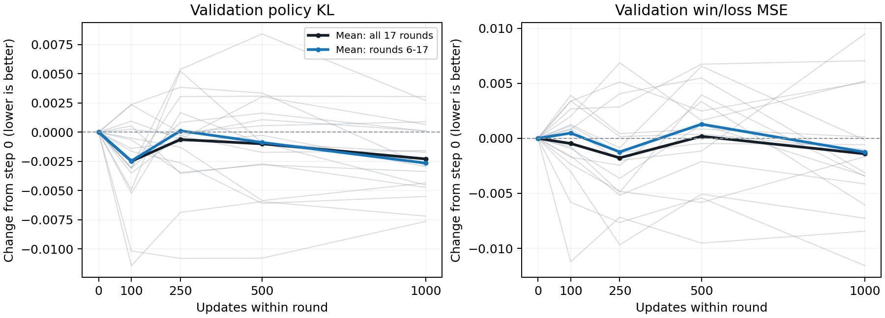

# 混合预算持续迭代：17轮训练轨迹

2026-10-20，仅汇总已有日志；未启动训练、重算网络指标或新增棋力赛。轮号为本分支第1–17轮，不是原R24–R43。

## 口径

- 每轮0/100/250/500/1000步使用同一份2048局面；脚本逐文件核对references与pool digest。跨轮重新抽样、池与教师也变化，不能把跨轮绝对值视为固定测试集上的趋势。
- policy只使用2048局面中正权重的高预算／历史有效步骤；value使用全部2048。前5轮还在替换旧数据，第6轮起全为新分支数据。
- Train为前250/后250步随机minibatch均值，不是固定Train子集。KL单位为nat，CE是policy loss，MSE是value loss；KL+MSE是诊断量，不是棋力。
- 日志没有value预测方差、相关系数或top1准确率；不能从这些聚合量反推这些指标，或把MSE直接分解为不可约噪声。

细灰线为各轮，黑线为17轮等权均值，蓝线为第6–17轮均值；这些轮次的池相互重叠，不将它们当独立样本生成显著性结论。

## 平均轮内轨迹

| 范围／指标 | 0 | 100 | 250 | 500 | 1000 | 终点减起点 |
| --- | ---: | ---: | ---: | ---: | ---: | ---: |
| 1–17轮 KL | 0.438923 | 0.436436 | 0.438293 | 0.437925 | 0.436631 | -0.002292 |
| 1–17轮 CE | 1.666023 | 1.663537 | 1.665394 | 1.665026 | 1.663731 | -0.002292 |
| 1–17轮 MSE | 0.759663 | 0.759193 | 0.757889 | 0.759846 | 0.758256 | -0.001407 |
| 6–17轮 KL | 0.439252 | 0.436788 | 0.439368 | 0.438371 | 0.436605 | -0.002647 |
| 6–17轮 CE | 1.667117 | 1.664652 | 1.667232 | 1.666236 | 1.664469 | -0.002647 |
| 6–17轮 MSE | 0.760858 | 0.761334 | 0.759623 | 0.762146 | 0.759599 | -0.001258 |

## 观察到的规律与边界

1. **policy仍在学习，但每轮吸收幅度小。** 终点KL优于起点的轮数为11/17，平均下降0.002292，约为起点KL的0.52%；Train前250到后250步平均下降0.002191。第6–17轮中9/12轮终点KL改善。不能把小幅学习说成完全停学。
2. **早期KL较好，不等于训练只该跑100步。** 17轮平均KL在100步已下降0.002487，100到1000步平均反升0.000194；12/17轮观察到的最低KL在100或250步。但KL＋MSE最低点有9/17轮在1000步，它的17轮平均值也是1000步最低。单一KL不足以决定联合训练的停止点，更不能代替棋力评测。
3. **value不是每轮都过拟合，后期泛化收益却在减弱。** 全17轮终点MSE改善12/17轮，平均变化-0.001407。第6–11轮6/6轮终点改善，平均-0.002772；第12–17轮仅3/6轮改善，平均+0.000255，同期Train窗口MSE平均变化-0.005005。第13/14/17轮为Train降而留出升，其中第14轮仅+0.000119，不能都当成明确退化。
4. **跨轮绝对值混合了模型变化与面板变化。** 例如第11轮终点MSE为0.808990，第16轮为0.732222，相差0.076768；每轮训练造成的MSE变化通常在0.01以内。这些幅度不能用来估计纯抽样噪声，因为池、标签教师和模型都变了。更适合比较同轮0→1000的配对变化。
5. **policy诊断样本量随着预算随机化下降。** 第1–5轮有效policy局面为1485/1305/1114/869/656，第6–17轮只有406–446；value仍为2048个局面，来自约1337–1396个独立对局。跨轮留出KL的起伏不能直接解释成模型来回变强变弱。
6. **loss与梯度补充信息。** CE等于目标熵＋KL；同轮目标熵不变，CE与KL的增减完全相同，并非另一份独立证据。Train总loss窗口平均下降0.005352。每轮梯度范数均值从3.373升到3.888，全部17000步都触发clip1；现有日志没有分头梯度，不能据此认定value主导或裁剪就是主因。
7. **现阶段判断与下一步建议。** 支持“policy小幅持续吸收，value后期泛化收益减弱”；不支持“学习完全停止”“所有轮次都value过拟合”或“100步一定优于1000步”。下一步优先固定一套跨轮不变、直接抽有效policy步的诊断集，并把value按高/低预算及数据代次分层，补预测方差／相关系数；固定Train子集也有助于区分拟合不足与泛化不足。本次只提出建议，没有修改训练或新增网络评测。

## 各轮留出KL

| 轮 | 0 | 100 | 250 | 500 | 1000 | Δ1000−0 | 最低点 |
| ---: | ---: | ---: | ---: | ---: | ---: | ---: | ---: |
| 1 | 0.446097 | 0.435929 | 0.435293 | 0.435314 | 0.438457 | -0.007640 | 250 |
| 2 | 0.425133 | 0.424477 | 0.421687 | 0.422340 | 0.421763 | -0.003371 | 250 |
| 3 | 0.421997 | 0.418921 | 0.425042 | 0.425076 | 0.425041 | +0.003044 | 100 |
| 4 | 0.432244 | 0.432500 | 0.431970 | 0.433314 | 0.432355 | +0.000111 | 250 |
| 5 | 0.465198 | 0.466139 | 0.464581 | 0.468231 | 0.465850 | +0.000652 | 250 |
| 6 | 0.491522 | 0.489884 | 0.488894 | 0.485427 | 0.486017 | -0.005505 | 500 |
| 7 | 0.475373 | 0.471862 | 0.475056 | 0.473643 | 0.473789 | -0.001584 | 100 |
| 8 | 0.477238 | 0.474134 | 0.478063 | 0.478868 | 0.477330 | +0.000092 | 100 |
| 9 | 0.423446 | 0.425808 | 0.427290 | 0.426794 | 0.420549 | -0.002897 | 1000 |
| 10 | 0.435235 | 0.433835 | 0.434379 | 0.434966 | 0.432281 | -0.002954 | 1000 |
| 11 | 0.418065 | 0.417550 | 0.416780 | 0.412207 | 0.413716 | -0.004349 | 500 |
| 12 | 0.436858 | 0.439211 | 0.436815 | 0.437409 | 0.437744 | +0.000886 | 250 |
| 13 | 0.409585 | 0.398156 | 0.402715 | 0.403639 | 0.402399 | -0.007186 | 100 |
| 14 | 0.415421 | 0.415958 | 0.411880 | 0.412698 | 0.410691 | -0.004730 | 1000 |
| 15 | 0.435110 | 0.432045 | 0.440483 | 0.443519 | 0.437827 | +0.002717 | 100 |
| 16 | 0.394851 | 0.389918 | 0.400072 | 0.393932 | 0.390323 | -0.004529 | 100 |
| 17 | 0.458319 | 0.453092 | 0.459988 | 0.457355 | 0.456592 | -0.001727 | 100 |

## 各轮留出MSE

| 轮 | 0 | 100 | 250 | 500 | 1000 | Δ1000−0 | 最低点 |
| ---: | ---: | ---: | ---: | ---: | ---: | ---: | ---: |
| 1 | 0.781951 | 0.776142 | 0.774304 | 0.776544 | 0.770376 | -0.011576 | 1000 |
| 2 | 0.732644 | 0.733512 | 0.730631 | 0.731486 | 0.742135 | +0.009491 | 250 |
| 3 | 0.743871 | 0.732651 | 0.736699 | 0.734347 | 0.735430 | -0.008441 | 100 |
| 4 | 0.746216 | 0.745299 | 0.742579 | 0.747477 | 0.742814 | -0.003402 | 250 |
| 5 | 0.779300 | 0.782670 | 0.784423 | 0.781785 | 0.784404 | +0.005105 | 0 |
| 6 | 0.751854 | 0.748821 | 0.742175 | 0.746784 | 0.744584 | -0.007270 | 250 |
| 7 | 0.755473 | 0.758879 | 0.755633 | 0.755862 | 0.754453 | -0.001020 | 1000 |
| 8 | 0.757997 | 0.759127 | 0.756699 | 0.757527 | 0.757420 | -0.000577 | 250 |
| 9 | 0.734321 | 0.735580 | 0.733458 | 0.740877 | 0.734164 | -0.000158 | 250 |
| 10 | 0.764540 | 0.763772 | 0.759637 | 0.768490 | 0.761081 | -0.003459 | 250 |
| 11 | 0.813140 | 0.811535 | 0.807971 | 0.811029 | 0.808994 | -0.004146 | 250 |
| 12 | 0.785293 | 0.783575 | 0.782843 | 0.788630 | 0.779237 | -0.006057 | 1000 |
| 13 | 0.771644 | 0.774310 | 0.774508 | 0.778385 | 0.778697 | +0.007053 | 0 |
| 14 | 0.749495 | 0.753403 | 0.749924 | 0.750342 | 0.749620 | +0.000124 | 0 |
| 15 | 0.752499 | 0.750157 | 0.747682 | 0.746672 | 0.750839 | -0.001660 | 500 |
| 16 | 0.735350 | 0.736155 | 0.739409 | 0.740836 | 0.732224 | -0.003127 | 1000 |
| 17 | 0.758683 | 0.760691 | 0.765542 | 0.760316 | 0.763881 | +0.005198 | 0 |

## Train与留出方向

| 轮 | Train ΔKL | 留出 ΔKL | Train ΔMSE | 留出 ΔMSE | 有效policy局面 | 留出来源局数 | greedy得分 |
| ---: | ---: | ---: | ---: | ---: | ---: | ---: | ---: |
| 1 | -0.001045 | -0.007640 | -0.007555 | -0.011576 | 1485 | 1378 | 57.375% |
| 2 | -0.002016 | -0.003371 | -0.003003 | +0.009491 | 1305 | 1381 | 55.650% |
| 3 | +0.001585 | +0.003044 | -0.002214 | -0.008441 | 1114 | 1385 | 59.325% |
| 4 | -0.001754 | +0.000111 | -0.001617 | -0.003402 | 869 | 1380 | 60.750% |
| 5 | -0.007566 | +0.000652 | -0.009672 | +0.005105 | 656 | 1337 | 59.625% |
| 6 | -0.009360 | -0.005505 | +0.001155 | -0.007270 | 430 | 1380 | 63.525% |
| 7 | -0.001956 | -0.001584 | +0.000543 | -0.001020 | 420 | 1362 | 62.000% |
| 8 | -0.000077 | +0.000092 | -0.002062 | -0.000577 | 427 | 1378 | 63.425% |
| 9 | -0.001604 | -0.002897 | -0.001324 | -0.000158 | 416 | 1396 | 65.000% |
| 10 | -0.002335 | -0.002954 | -0.001815 | -0.003459 | 444 | 1373 | 64.425% |
| 11 | -0.003550 | -0.004349 | -0.003006 | -0.004146 | 444 | 1358 | 64.775% |
| 12 | -0.006881 | +0.000886 | -0.001792 | -0.006057 | 406 | 1377 | 64.825% |
| 13 | -0.001767 | -0.007186 | -0.006549 | +0.007053 | 446 | 1389 | 67.225% |
| 14 | +0.002434 | -0.004730 | -0.002475 | +0.000124 | 446 | 1385 | 65.825% |
| 15 | -0.002542 | +0.002717 | -0.009084 | -0.001660 | 432 | 1372 | 67.725% |
| 16 | +0.001043 | -0.004529 | -0.001395 | -0.003127 | 421 | 1358 | 66.625% |
| 17 | +0.000153 | -0.001727 | -0.008737 | +0.005198 | 441 | 1371 | 65.975% |

## 可复核产物

- `validation_by_step.csv`：85个checkpoint的KL、CE、MSE、熵、有效数和模型SHA。
- `round_summary.csv`：每轮Train窗口、留出变化、观察到的最低点、梯度、池大小与已完成对战。
- `summary.json`：分组均值、方向计数、最低点分布、输入文件SHA。观察到的最低点经过5次挑选，天然偏乐观；不能据此直接确定最优更新步数或最强checkpoint。

复现统计：`conda run -n splendor env PYTHONPATH=src python artifacts/entity_attention_random_budget_iteration_20261019/analyze_learning_curves.py`。绘图：在已有Matplotlib的base环境执行同一脚本并加`--plot-only`；没有修改splendor环境依赖。
