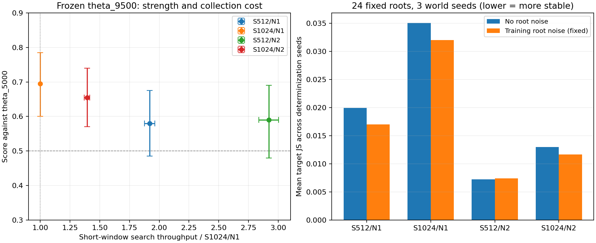

# Attention 自迭代教师 S/N 有限筛选（2026-10-05）

下一阶段推荐试训 **S512/N2** 与 **S1024/N2**：前者优先降低采集成本，后者保留更多单世界搜索预算。现有 S1024/N1 继续作为参考。筛选已完成，未执行权重更新，也未改动正式训练配置或进程。

后续实现：已新增[第九轮N2分支入口与数据替换日程](../../docs/guides/entity_attention_hybrid_fork_zh-CN.md)。本报告的测量、源码身份及训练未执行的结论均记录筛选当时状态；当前代码已继续演进，复核需使用记录的源码版本或runtime中的快照。

这里筛选的是值得训练验证的教师配置，尚未证明哪组能带来更高的长期学习速度。用户最关心采集成本，因此选择兼顾现有棋力、生产吞吐与训练目标对世界抽样种子的敏感性。

## 结果与选择

冻结第九轮结束的 `theta_9500`，对手始终是 `theta_5000` 的 S1024/N1 MCTS。得分率按胜=1、和=0.5、负=0 计算；每组50个种子，各换座两局。

| 配置 | 胜/负/和 | 得分率及95%配对区间 | 相对基线得分差及95%区间 | 搜索吞吐倍数 | 训练根噪声下目标 JS |
| --- | --- | --- | --- | --- | --- |
| S512/N1 | 57/41/2 | 58.0% [48.5%, 67.5%] | −11.5pp [−23.5, +1.0] | 1.92× [1.88, 1.96] | 0.01702 |
| S1024/N1 | 69/30/1 | 69.5% [60.0%, 78.5%] | 0 | 1.00× | 0.03203 |
| **S512/N2** | **59/41/0** | **59.0% [48.0%, 69.0%]** | **−10.5pp [−23.0, +2.0]** | **2.92× [2.84, 3.00]** | **0.00741** |
| **S1024/N2** | **65/34/1** | **65.5% [57.0%, 74.0%]** | **−4.0pp [−16.0, +8.5]** | **1.39× [1.37, 1.42]** | **0.01166** |

吞吐为两次生产短窗口的 `simulations/sec ÷ S`，再与同一遍的 S1024/N1 相除；方括号是两遍测量范围，**不是置信区间，也不是整局采集速度**。JS 是同一根局面在不同世界抽样种子下的完整 policy target 分布差异，越低表示该项敏感性越小。

- **S512/N2 是优先候选。** 对共同对手的得分点估计与 S512/N1 接近（+1pp，差值区间 [−11.5, +14.0]pp），短窗口搜索吞吐约为它的1.52倍。训练噪声条件下，目标 JS 比 S512/N1 低约56.5%。相对当前 S1024/N1 有明显的成本优势，但教师得分点估计低10.5pp，必须用后续训练检验这个取舍。
- **S1024/N2 是兼顾棋力的候选。** 相对当前基线少4pp，短窗口吞吐提高约39%，训练噪声下目标 JS 下降约63.6%。它比 S512/N2 多一倍总模拟预算，每个世界有512次模拟，适合检验更多搜索能否带来足够的学习收益。
- **S512/N1 暂不优先试训。** 本次没有看到它相对 S512/N2 的棋力点估计优势，吞吐更低，目标对世界种子更敏感。这是资源排序，不是统计意义上的被支配证明。
- **S1024/N1 保留为现有参考。** 它的得分点估计最高；本次没有证明 N2 教师等强或更强。所有候选与基线的配对差值区间都跨0，样本量只适合初筛。两个新增试训名额用于 N2 的低预算与高预算版本。



## N2 的实际含义与局限

现行实现把 **S 作为每个可搜索根的总预算**，分给 N 个 determinization 世界，再平均各世界归一化的访问分布。S512/N2 是256+256；S1024/N2 是512+512，不是把模拟总数翻倍。可核对 `src/splendor/mcts_policy.py` 的 `self.budgets` 与 native 同一预算逻辑。

生产窗口中 N1 的平均逻辑推理 batch 约99.6，N2 约128；N2 的更多并行叶子请求有助于填满 batch。搜索也会变浅：评测平均每次模拟深度，S1024/N1 为4.217，S1024/N2 为3.731；S512/N1 为3.720，S512/N2 为3.263。两点都是本机实际成本取舍的组成部分，不能把 N2 的收益只归因于多世界平均。

目标分布更稳定不等于选出的动作更稳定，也不等于教师更强。无根噪声时，S1024/N2 跨世界种子的 top-1 动作变化率为31.9%，高于 S1024/N1 的22.2%，尽管完整分布 JS 明显更低。N2 的分布熵更高、搜索目标更接近网络 prior；这些现象可能来自平均与单世界预算下降，训练效果仍需测量。本次也没有检验 value 标签质量、梯度冲突或 policy/value 共享 trunk 的影响。

## 测量协议

**固定权重棋力：** 四组各100局，全数有效；三组新增评测，S1024/N1 复用第九轮已完成的正式结果。双方 FP32、native_batched compiled、active_games=100、max_batch_size=64、actor_projection=false、候选桶[16,32,48,64]、根噪声0、温度0。除候选 S/N 外，权重、共同对手、种子与其余配置一致。游戏种子14700000…14700049，policy_seed_base=14710000，search seed=14730000，配对 bootstrap seed=14720000、10000次重采样。使用已有 DEV 面板，未使用独立 FINAL 面板；未做多重比较校正。

**固定根目标：** 从当前 round-008 的8局 validation 对局中各取早/中/晚3个主行动局面，先用 checked engine 完整回放验证，共24个根，其中5个存在对手暗保留牌。四组×3个世界种子×24根×有/无根噪声，共576次搜索、442368次模拟。世界种子14830000/14830001/14830002；根噪声 sampling_seed=14840000 固定，fraction=0.25，温度0。CPU FP32 eager、1线程，只用于比较目标，不将其耗时用作 CUDA 生产成本。policy target 不因行为采样温度0变成 one-hot。

**生产成本：** 每组两遍，每遍 Graph 预热后先跑10秒真实游戏预热，再测35秒；第二遍逆序。单 CUDA owner、8个搜索 worker、100个活跃游戏，预置128局以维持供给，max_batch_size=128，local_microbatch=64，B桶[16,32,64,128]，C桶[16,32,48,64]，wait=5ms，**shared_slots=2、pipeline_slots=1、固定地址 native-cudagraph**，FP32、actor_projection=false。采集 seed=14800000，split seed=14810000，search seed=14820000；探索沿用 fraction=0.25、前10个双方合计回合温度1、之后0。两遍复用同一组游戏种子，用于成本复测，不是独立轨迹抽样。

八个窗口均确认实际 CUDA Graph capture/replay，20个预热编译入口均有效，编译失败、编译回退与 eager fallback 都为0。窗口主要覆盖开局/早中期；没有完整整轮采集结果，不能将2.92×直接承诺为完整100局的耗时缩短。四组棋力赛的总耗时还含固定对手、不同游戏长度和设置开销，不能替代单教师采集测速。

## 产物与复核

- [selected_candidates.json](selected_candidates.json)：恰好两组新增试训候选、角色与证据；不是可直接启动训练的配置。
- [screening_summary.json](screening_summary.json)：棋力、配对差值及根目标统计。
- [cost_comparison.json](cost_comparison.json)：8个窗口原始派生指标及重复范围。
- `eval_*.json`、`eval_*_header.json`：四组棋力原始汇总与面板头；`window_*.json`：8个成本原始汇总；[root_results.json](root_results.json)：576次逐根原始结果；[root_bank.json](root_bank.json)：完整公开根请求与输入 NPZ 哈希。
- [manifest.json](manifest.json)：checkpoint、配置、命令、种子、源码及产物哈希；[verification.json](verification.json)：有限审计结果。所有新 GPU 调用的11份 session/identity 保存在 `recording/`，记录当时机器与环境。历史 S1024/N1 的逐次源码 identity 未记录，不以本次代码身份补填。
- 完整棋力 sidecar、每次源码快照及 benchmark scratch 留在忽略的 `runtime/entity_attention_search_screen_20261005/`；模型和输入游戏留在 `runs/`，不因此纳管。

权重为 `runs/entity_attention_hybrid_static_graph_seed1/rounds/round-008/checkpoints/final.pt`，累计9500步，SHA-256 `af3b2b64007705cc9adcbb3e8a6ad68239f4dc967c31c515e857b1240479e44a`。固定对手 SHA-256 `6fec2039cfe5fa7e8775ec5b5692a5defadfa3ab21bdb398e400696be17b08db`。新调用基于 HEAD `0a176b1a269a9850f51e7350e475a6c801f82644` 加保留的 dirty 工作；源码集合哈希 `587e457382f3d064d9a9b564d96b1033a96d43154a46bf971acf6cb14eb6c6d2`，不能只用 HEAD 重现。

在仓库根目录复核已有结果，无 GPU 工作：

```bash
conda run --no-capture-output -n splendor env PYTHONPATH=src python artifacts/entity_attention_search_screen_20261005/verify.py
```

`screen.py` 的 prepare/bank/roots/digest/costs 分别准备输入、重建根、搜索、汇总棋力、汇总成本；新增棋力与生产窗口的完整执行命令见 manifest。prepare 会写本目录输入快照，roots 与 windows 会执行实验，不能当作只读复核命令。绘图仅依赖 JSON，使用已有 base 环境的 Matplotlib，不安装依赖、不加载模型：

```bash
conda run --no-capture-output -n base env MPLCONFIGDIR=/tmp/splendor_search_screen_matplotlib python artifacts/entity_attention_search_screen_20261005/plot.py
```

下一阶段从相同9500步起点分别试训这两组，以每轮100局/100步、相同 replay/混合比例/优化器设置比较，评测统一使用 S1024/N1，同时比较相同新局数与相同采集时间下的进步。正式新分支训练尚未执行；后续已实现fork入口，配置和命令见上面的专题指南，旧run仍要求配置匹配，不能直接修改旧配置冒充resume。若要严格估计 N2 的因果训练收益，还需相同条件的 N1 训练对照；现有500步/1000局训练不能直接替代该对照。

筛选任务仅新增此交付目录；后续分支入口交付已在实验索引登记本有限筛选，并标明两组仍是待训练验证的教师候选，原S1024/N1 run的冻结配置保留。
