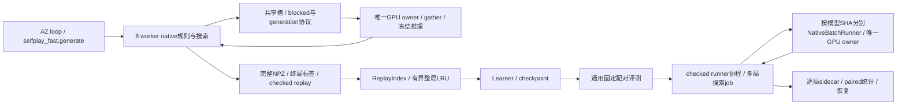

# 端到端速度优化与完整验收

2026-10-03 完成。两组各1,000局生产采集与全量checked replay、两组各50 pairs固定θ5/θ4评测、固定第五轮replay/θ4 optimizer的8步预热+128步learner对照均实际完成，工程异常/截断/缺失均0。优化已经接入生产调用链，主对照每组一次。

| 流程与完整计时范围 | baseline | optimized | 加速比 | 耗时下降 | 吞吐增长 |
| --- | ---: | ---: | ---: | ---: | ---: |
| 1,000局generate主墙钟 | 1714.56 s | 1384.04 s | 1.239× | 19.28% | 23.88% |
| 固定replay learner总成本（含准备/预热/128步/checkpoint/验证） | 92.25 s | 11.41 s | 8.082× | 87.63% | 708.17% |
| 固定50 pairs / 100局评测 | 682.17 s | 207.21 s | 3.292× | 69.63% | 229.22% |

主要收益分别来自采集宽档/搬运与无效尾部等待、大cache消除整局重复加载、跨局GPU合批替换CPU逐叶推理。当前瓶颈分别为采集供给/合批等待48.44%、充分升温learner的collate40.58%与训练步骤47.22%、评测非推理批次处理44.78%与forward主机区间42.02%。这些流程使用不同固定模型/数据，不把三组时间相加冒充一次完整AZ闭环。

## 源码与语义

原工作树快照及 hash、dirty diff、native 构建来源见 `artifacts/end_to_end_speed_2026-10-03/baseline_identity.json` 与 `baseline_dirty.patch`；优化快照见 `optimized_identity.json` 与 `optimized_dirty.patch`。HEAD 为 f213e6378559322d38ac5a3845118de1816950e2，但 HEAD 不能单独表示此次 dirty 源码。正式采集及优化评测使用独立 snapshot 的 PYTHONPATH 和脚本；CPU 评测使用基线 src 快照及记录 SHA 的外层计时脚本。两组不同时运行。未修改模型结构、S=1024/N=1、探索/温度、损失与合法候选。

采集采用 W=8/A=500/B=500、micro=64、slots=1、wait=5ms、FP32、reused/compiled、共享宽上限256。优化改动为实际供给槽 blocked 协议、控制事件优先处理、同布局块复制与仅 padding 后缀清零、64 档及超编译宽请求隔离；编译失败 fail_fast。正式墙钟由生产 generate 外层测量，包含其初始化、搜索、归档及运行内校验；额外全量 checked replay 单列。

learner 使用有界整局 LRU，大缓存只改变读取复用。缓存统计与容量、RSS、样本持有数组分开；索引、准备、预热、测量、checkpoint、validation 单独记录。引用序列及更新状态已核对，详见下文。

评测通过同一个 checked runner 协程推进规则；跨局 NativeBatchRunner 按 checkpoint SHA 与推理配置分别调度。每局保持原 policy seeds，pair/座位、循环判平、异常与 sidecar 恢复不变。执行配置参与身份，原 CPU 多进程配置保持可读。CPU→GPU 与批量化属于整条执行路径收益，不单独归功于一个算子。

正式采集checkpoint SHA=009d17d2…；评测θ5=e0cba773…、θ4=c4e85e27…，完整SHA见身份JSON。采集seed12347000、split12348000，评测game seeds9300000–9300049、policy seed base9400000。FP32、合法动作集合、标签、预算S1024/N1均保持。新配置导航为 `configs/speed_2026-10-03/`，旧冻结配置与历史run未改写。

## 仪器与计时边界

首次短窗逐行包装约下降17%；正式弃用该包装，其不完整 `collection_baseline` 现场保留，主对照为重新完成的 `collection_baseline_low`。按批聚合初测下降5.6%，但相邻复测关闭/开启分别为68,838.8/68,812.1行/秒，差0.039%，说明初测不能排除运行波动。两组正式采集使用相同按批包装；优化组另开启内联叶宽统计，该开关单次短测约有2.29%成本，正式收益包含这项成本，未事后扣除。

开局窗口、预热与完整 session 分开，不能拿窗口 positions/s 作完整 games/min。低频资源采样直接读取 /proc，树 RSS 含共享页重复，PSS按比例分摊；GPU设备总占用还包含桌面与驱动。RTX4050 Laptop 6GiB、16逻辑CPU、约32GiB主存；Python3.12.14、Torch2.14.0+cu130、CUDA13.0、驱动580.178.04。OMP/MKL/OpenBLAS/Torch均1线程，未改电源设置或终止用户进程。各会话温度、功耗、时钟和CPU时间序列保留在 `*.session-1.resources.json`。

owner 的输入等待、合批等待、gather、dispatch、推理主机 forward/H2D/D2H/完成等待互斥；worker 的规则/编码/写档累计成本与 owner 并行，不相加为墙钟。CUDA event elapsed 为设备流区间，不称纯 kernel 时间。尾部 last100/10/8/1 是嵌套区间，不直接相加。原计数器 deadline 把各种未满批情况合并，不代表真实超时。旧 JSON 与 hash 保留，旧报告已补清口径。

## 完整 1,000 局采集

两组1000/1000，missing/error/engineering truncation/batch failure均0，逐局NPZ、manifest、status、summary完整，全量checked replay通过。主墙钟从调用generate到返回，包含模型加载、首次编译、进程建立、规则/搜索/归档及运行内校验；不是summary中仅采集session的1705.92/1375.32秒。

| 指标 | baseline | optimized |
| --- | ---: | ---: |
| 生产主墙钟 | 1714.564 s | 1384.043 s |
| 额外全量checked replay | 35.070 s | 36.152 s |
| 含额外回放交付时间 | 1749.634 s | 1420.196 s |
| 局/分钟 | 34.994 | 43.351 |
| 有效policy样本/秒 | 37.545 | 46.506 |
| 全部样本/秒 | 50.479 | 62.539 |
| simulations/秒 | 38,445.9 | 47,621.9 |
| policy样本数 | 64,373 | 64,366 |
| 全部样本数 | 86,550 | 86,557 |
| simulations | 65,917,952 | 65,910,784 |
| 物理推理行数 | 59,940,914 | 59,928,113 |
| 平均物理batch / B500填充率 | 404.82 / 80.96% | 397.65 / 79.53% |
| NPZ数据字节 | 44,933,579 | 44,933,727 |

主墙钟加速1.239×，耗时下降19.277%，吞吐增长23.881%；含额外回放加速1.232×。simulation量只下降0.0109%，按工作量归一化仍快23.87%，收益不是减少搜索预算。双方合计对局回合均值56.072/56.068，p90=60、p99=64、最大68。含排队根决策延迟p50/p90/p99为11.098/15.342/16.008秒和9.127/12.906/13.859秒；500活跃局并行，不能把此延迟当作单局独占搜索时间。

### owner 时间占比与收益来源

| 互斥主机区间 | baseline 秒 / 主墙钟占比 | optimized 秒 / 主墙钟占比 |
| --- | ---: | ---: |
| 首请求输入等待 | 269.51 / 15.72% | 242.30 / 17.51% |
| 合批等待 | 505.48 / 29.48% | 428.18 / 30.94% |
| gather | 355.03 / 20.71% | 213.84 / 15.45% |
| dispatch | 34.16 / 1.99% | 37.23 / 2.69% |
| forward主机区间 | 293.27 / 17.10% | 254.43 / 18.38% |
| H2D提交 | 35.19 / 2.05% | 30.54 / 2.21% |
| D2H提交 | 18.71 / 1.09% | 16.62 / 1.20% |
| 设备完成等待 | 117.24 / 6.84% | 29.17 / 2.11% |
| 初始化、控制处理、归档校验及其他余量 | 85.97 / 5.01% | 131.73 / 9.52% |

这是一套owner墙钟分解；forward含主机调用/可能的首次图建立，H2D/D2H为提交区间，wait为完成等待，均不是纯kernel时间。worker成本同时发生，不能加到此表。规则实推进累计36.20→37.04秒、根编码73.75→76.55秒、写档33.25→33.14秒；叶编码和native搜索发生在fill/compute内，现有native_encoding_seconds=0表示未独立计时，不表示零成本。worker累计native fill 856.15→862.62秒，累计CPU3441.69→3610.33秒，累计结果等待10121.35→7592.43秒、队列背压28.76→27.66秒。新增控制事件与叶宽计数有CPU成本，余量不能被命名为单一瓶颈。

gather绝对下降141.19秒、39.77%。短开局同负载微测只见每行3.108→2.819μs（9.3%下降），开局总吞吐没有确定提升；完整轮的大收益还包含64档减少填充/搬运，不能将全部141秒归因于复制代码。宽档推理主机全路径从256档的141.25秒变为64档32.14秒；该区间包含传输、forward和完成等待，不能再和上表相加。少量64档及gather联合降低宽请求放大整批的成本。

优化后输入+合批等待仍为48.44%，gather15.45%，GPU利用率5秒采样均值19.34%。当前主要瓶颈仍在CPU搜索供给、进程/槽协调与数据整理，单独增大GPU或B不能由这些结果证明有效。dispatch略增、其他余量上升；此次没有逐项完整轮消融，分项差是联合改动下的实测差，不是独立因果归因。

### 宽度、padding与真实等待

| owner物理档位 | baseline 行 / 推理全路径秒 | optimized 行 / 推理全路径秒 |
| --- | ---: | ---: |
| 16 | 1,412 / 1.55 | 1,377 / 0.61 |
| 32 | 7,768,112 / 61.21 | 7,917,282 / 50.25 |
| 48 | 46,798,194 / 291.85 | 46,687,098 / 278.01 |
| 256 / 64 | 5,373,196 / 141.25（256） | 5,322,356 / 32.14（64） |

baseline有11,952次宽档eager，编译失败0；optimized的150,704次均进入compiled、eager0、编译失败0，16/32/48/64计581/24,184/113,972/11,967次。两组均复用已有磁盘编译缓存，首次图路径累计约4.08/4.02秒，不是删除缓存后的冷编译测量；四个逻辑档共3个Dynamo图，64复用动态宽图。fail_fast已额外覆盖Dynamo缓存限额的隐式eager回退。

物理候选容量3,870,453,664→2,834,986,544（下降26.75%）；owner padding为1,836,773,508→801,832,132。优化组实际叶候选1,163,586,476、worker padding869,567,936，加owner padding恰好核对物理容量，总padding58.96%。基线未采集逐叶宽，不能给它编造worker padding；基线worker描述符容量可由owner差额核对为2,033,680,156。优化组真实>48仅12,596行（0.0210%），却使64档承载8.88%物理行，证明存在微批和owner两层放大；共享上限256保留，没有截断候选。

根阶段按双方合计回合数统计，与整轮尾段不同：<10为10,672,300行、平均20.55候选；10–49为46,674,125行、平均19.23；≥50为2,581,688行、平均18.09。全部是policy行，value-only=0（此次N=1形状；相关混合路径另有回归）。

优化组实际触发：满批74,634批/37,317,000行；真实deadline46,839批/17,284,418行；可供给槽到齐29,231批/5,326,695行；生产者耗尽0。等待时间分别154.56/231.72/41.90/0秒，合计428.18秒。槽到齐触发仍可能先等先前正在供给的worker，不能理解为该类总等待零。原基线deadline标签不能与此真实超时数量直接比较。

### 完成进度与尾段

| 阶段（到最终逐局提交） | baseline | optimized |
| --- | ---: | ---: |
| 50% / 90% / 99% / 全部完成秒 | 918.90 / 1584.72 / 1643.32 / 1705.82 | 761.49 / 1328.83 / 1361.54 / 1375.02 |
| 最后100局秒 / 行 / batch | 121.10 / 367,778 / 15,018 | 46.19 / 374,324 / 14,961 |
| 最后10局秒 / 行 / batch | 62.50 / 26,514 / 6,675 | 13.48 / 26,013 / 6,460 |
| 最后8局秒 / 行 / batch | 57.36 / 21,257 / 6,114 | 12.49 / 21,608 / 5,992 |
| 最后1局秒 / 行 / batch | 4.38 / 500 / 500 | 0.43 / 252 / 252 |

这些是嵌套区间。最后10局耗时下降78.44%，工作量相近，是无效等待消除的强证据；最后1局剩余叶数不同，不能把10倍全部归因于调度。优化最后1局合批等待0，2–8局区间仅0.979秒。并未跳过任何对局。最后100局节省74.91秒，整轮节省330.52秒，收益同时存在于大规模推进和尾段。

相同种子下996/1000局完整trace一致，999局赢家一致、997局长度一致；P0/P1胜/平为503/479/18和502/480/18。真实归档输入宽30、51的PPO/θ5/θ4固定对照中，CPU与GPU宽档eager/64档compiled logits最大绝对差≤3.815e-6，value≤2.385e-7，6个对照argmax均一致。这只核验少量固定输入；浮点舍入、batch形状可能累计改变搜索分支，不宣称全部树逐位一致。

采集进程树峰值PSS5.73→5.63GiB；RSS相加13.50→13.37GiB含共享页重复。PyTorch分配峰值297.92→69.03MiB，优化reserved98MiB，基线旧计时脚本未记录reserved。设备总占用峰值1185→719MiB；平均GPU利用率19.70→19.34%，温度最高65→61°C，采样平均功耗18.15→16.97W。显存下降与256档消除一致，但设备总量含桌面，不能等同张量容量。

## 固定 replay learner 对照

固定既有第五轮replay、θ4 parent optimizer、batch256/history128和原抽样种子，各独立8步预热+128步测量，不续接前一组诊断。

| 区间 | 256 MiB | 2 GiB | 加速 |
| --- | ---: | ---: | ---: |
| 准备、初始化、预热、测量、checkpoint与validation总计 | 92.249 s | 11.415 s | 8.082× |
| 8步预热 | 5.587 s | 4.349 s | 1.285× |
| 128步测量 | 84.037 s | 5.062 s | 16.603× |
| 最后32步 | 20.733 s | 0.377 s | 54.94× |

测量步/秒1.523→25.289；总成本下降87.63%，128步区间下降93.98%。256MiB组draw占82.42/84.04秒（98.08%），最后32步仍6012次miss；2GiB最后32步仅2次miss、draw0.0316秒（8.36%），collate0.1531秒（40.58%）、训练步骤0.1782秒（47.22%，其中forward/backward/optimizer等详见JSON）。旧瓶颈是整局load_game（ZIP/NPY解析、解码和构造），不能统称磁盘或zlib；大cache确实消除了反复加载。collate成为相对大项，但每步仅约4.8ms，未引入数据库或预取。

包含准备和预热的cache统计：256MiB保留409项/268,059,883字节，13,249hit/25,893miss，解码16,928,708,223字节、加载86.16秒；2GiB保留2289项/1,501,268,854字节，36,853hit/2289miss，解码1,501,268,854字节、加载7.57秒。cap是LRU保留数组上限，非RSS上限；样本可继续引用淘汰数组。

引用序列SHA一致（6549bb79…），128步loss差全部0；模型张量逐位一致（1982987e…），optimizer状态及DeterministicRng一致，136步更新数一致。两次新round初始化的全局Torch RNG快照不同；原continue_from不恢复这项，当前模型/更新不消费它，不声称所有RNG状态一致，也未为对齐而修改训练算法。索引1.551→0.952秒、验证准备0.163→0.158秒、初始化0.794→0.786秒、checkpoint0.0074→0.0067秒、validation0.0859→0.0810秒。

新优化1000局产物中保留32局，已实际两步batch16训练、验证并保存诊断checkpoint，主墙钟1.903秒；正式棋力面板继续用固定θ5/θ4。首次smoke仅脚本history_batch_size=0不符合现行正整数契约，训练前明确失败；改为16、history_pool=None后新目录 `new_data_learner_smoke_v2` 通过，原现场未覆盖。固定输入对照首次脚本漏schema字段也在forward前失败并保留输入，补字段后的v2通过；均非生产算法失败。

5秒采样进程树PSS峰值1.78→2.96GiB，RSS1.79→2.96GiB；两组PyTorch allocated峰值96.31MiB、reserved158MiB相同。2GiB组只有3个资源采样点，GPU利用率等不宜当作稳定均值。独立4步预热+4步cProfile/CUDA event短诊断另存 `learner_cuda_events_short.json`，不参与正式排名；测量4步的设备流区间target/feature H2D=1.055/3.001ms、forward6.742ms、loss1.009ms、backward8.112ms、clip2.131ms、optimizer3.332ms。event包含流内kernel、拷贝及可能的主机提交间隙，不是纯kernel成本；这些4步仍在cache升温，不能替代正式最后32步。

## 完整 50 pairs 固定评测

两组50/50 pairs、100/100局，passed=true，异常/非法动作/invariant失败/工程截断均0。baseline为native CPU eager、8 workers、每worker1线程；optimized为native_batched、CUDA唯一owner、active100、B64、16/32/48/64档、FP32、actor projection、reused staging、compiled/fail_fast、wait0。合作式调度每次推进已就绪叶请求；单owner当前可供给job都在手中，额外等待不会产生新供给，因此wait0是该路径的显式语义，与采集5ms等待不同。

短S64真实16局对照中active/B8为18.85秒，active/B16为11.83秒，均完成且平均决策86.1875相同；少量compiled两模型smoke通过。正式取整个100局面板为active、B64封顶，而非照搬采集B500。正式两模型平均物理batch40.32/40.45、最大60/59，实际fill约63.1%；尾部立即派发，未等64满批。

| 指标 | baseline | optimized |
| --- | ---: | ---: |
| 完整面板主墙钟 | 682.175 s | 207.209 s |
| pairs / 分钟 | 4.398 | 14.478 |
| 局 / 分钟 | 8.795 | 28.956 |
| simulations | 6,715,392 | 6,715,392 |
| simulations / 秒 | 9,844.1 | 32,408.8 |
| θ5 / θ4 simulations | 3,331,072 / 3,384,320 | 同左 |
| θ5 / θ4推理行 | 3,101,656 / 3,143,893 | 3,101,657 / 3,143,893 |
| θ5 / θ4物理批次 | 3,101,656 / 3,143,893（batch1） | 76,924 / 77,722 |
| θ5 / θ4平均batch | 1 / 1 | 40.32 / 40.45 |
| 平均合计回合 / 决策 | 57.08 / 86.17 | 同左 |
| θ5胜 / 平 / 负，score | 52 / 1 / 47，52.5% | 同左 |
| θ5先手 W/D/L，score | 28/0/22，56% | 同左 |
| θ5后手 W/D/L，score | 24/1/25，49% | 同左 |
| paired bootstrap 95% CI | [42%, 62.5%] | 同左 |

主墙钟加速3.292×，耗时下降69.63%，吞吐增长229.22%；模拟量相同，工作量归一化加速相同。100局paired seeds、座位与模型身份全部核对，终态digest、结果、长度和决策数均一致；lean sidecar不含完整动作trace，不能声称逐动作/逐叶一致。θ5多1个expanded node/推理行、少1个terminal hit，θ4 tree_depth_sum少11，存在极小数值分支差异而非工作量削减。自然终局100、policy-cycle判平0。工程完成及相同面板计分不构成新的棋力提升结论。

### 两条执行路径的计时分母

baseline以下为8 worker累计搜索墙钟5183.17秒内的互斥分项，不能加到682.17秒面板墙钟，也不能和优化owner表直接相减：core forward4064.32秒（78.41%）、tensor整理286.22秒（5.52%）、推理其余534.83秒（10.32%）、搜索除推理297.80秒（5.75%）。推理全路径合计94.25%。θ5/θ4推理全路径累计2428.98/2456.39秒，core forward2020.55/2043.76秒；每搜索决策累计平均约0.792/0.789秒。旧native stats的inference_seconds/model_batches=0未覆盖此路径，采用外层实际调用计数与计时，不能将0解释为零成本。

baseline主墙钟包含worker启动、模型首次加载、真实规则、sidecar与汇总，正式轻量包装只细分搜索/推理，未单独解析这些外围成本；历史单pair细画像仅作辅助说明，不把它外推成正式面板分项。优化owner分项则直接互斥核对到207.21秒：

| 区间 | 秒 | 主墙钟占比 |
| --- | ---: | ---: |
| 两模型建立 | 0.889 | 0.43% |
| checked规则推进 | 5.023 | 2.42% |
| root job建立 | 2.497 | 1.21% |
| batch非推理处理 | 92.795 | 44.78% |
| forward主机区间 | 87.077 | 42.02% |
| H2D / D2H提交 | 4.706 / 5.791 | 2.27% / 2.79% |
| 完成等待 | 2.429 | 1.17% |
| sidecar提交 | 0.468 | 0.23% |
| 调度其余与汇总 | 5.534 | 2.67% |

θ5/θ4 batch全路径97.17/95.62秒，其中推理51.25/48.76秒、非推理45.93/46.87秒。非推理内native fill累计24.59秒、consume44.28秒，余下约23.93秒为计划/缓冲/请求身份等批次处理；fill/consume已包含在92.795内。根延迟含其他局/模型调度，θ5 p50/p90/p99=2.793/3.072/5.844秒，θ4=2.789/3.071/5.844秒，不等同单局独占CPU成本。无额外凑批等待；完整batch/宽度分布见summary与原执行统计。

θ5的16/32/48/64档行数4,096/1,984,731/1,077,233/35,597，θ4为4,656/1,899,645/1,202,039/37,553；总物理候选容量238,526,720，实际105,075,384，padding55.95%。全154,646批compiled、eager0、编译失败0，每模型3个Dynamo图；首次图路径累计约4.74秒计入主墙钟，不是纯冷缓存编译。模型路由各自独立，没有普通worker复制CUDA模型。

评测进程树PSS峰值2.83→1.77GiB；RSS相加4.60→7.95GiB，优化编译子进程/共享映射会重复计入，不能据RSS和PSS不同方向判断泄漏。CPU基线PyTorch CUDA分配0，设备GPU利用率/占用来自图形等其他负载；优化allocated21.50MiB、reserved28MiB、设备总占用峰值618MiB、平均利用率26.27%、最高63°C、平均功耗17.14W、SM平均2016.6MHz。GPU容量有余量，但native/主机批次处理和forward均有明显份额，不能单独把3.292×全部归给GPU、projection或compile。

## 回归、产物与下一步

86项相关回归通过（含真实CUDA），后续35项目标回归、11项推理回归和1项新AZ批量评测闭环通过，部分重复，不以累计次数当作不同测试数量。覆盖当前供给槽/退出/分段/混合请求/gather、同抽样/更新、两模型逐候选对齐、座位种子/循环/异常/恢复、Dynamo限额明确失败；正式数据和面板再提供完整生产验证。统计汇总脚本同时断言1000局完整性、行/批/两层padding核算、面板身份与互斥计时余量。测试记录见 `tests.json`、`preflight_tests.xml`、`inference_tests.xml`、`batch_loop_test.xml`。

完整NPZ与可恢复manifest/status在 `runtime/end_to_end_speed_2026-10-03/collection_{baseline_low,optimized}/`；两组评测summary与完整 `.json.games/` sidecar在同runtime根目录。固定数据诊断checkpoint、失败现场、源码/脚本快照也保留runtime。长期聚合与逐局统计见 [summary.json](../../artifacts/end_to_end_speed_2026-10-03/summary.json)，命令/身份/清单见 [验收产物](../../artifacts/end_to_end_speed_2026-10-03/README.md)。单机、每组一次、已有编译缓存和不对称叶宽统计均已限定，不能外推所有设备或多轮训练；未完成项为预算外的新多轮棋力训练和重复稳定性研究，不属于本次要求。

最值得继续做的三项，按当前证据排序：

1. 采集CPU供给与共享槽调度：先用短时间线区分428秒合批等待中的供给间隙/队列协调，再减少槽处理和worker/owner之间的重复宽度布局转换。保留有用合批等待，不能直接全程wait0；目标是48.44%的等待和15.45%的gather。
2. 评测batch处理：在原生侧合并fill/consume/身份整理、减少Python每批调度，或有限验证CPU搜索供给与GPU owner重叠；目标92.79秒非推理区间。先测单项收益，不直接扩大成多worker/GPU矩阵。
3. learner collate：cache命中后批量构造/复用固定字段缓冲，减少4.8ms/步整理成本；严格保持引用顺序/RNG/current-history比例。相对份额高但绝对很小，优先级低于前两项。
