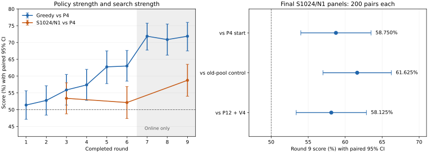
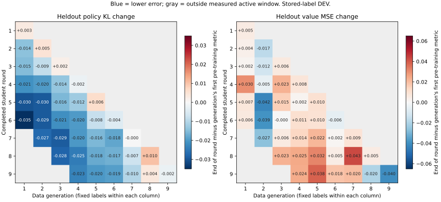

# P4 起点九轮自迭代：完整结果与结论

2026-10-10。正式任务已全部完成，包括九轮主线、同预算纯旧池对照、双方旧池全量留出评估，以及最后两组搜索对战。完成依据为本地 `runs/entity_attention_p4_pool_iteration_20261010/complete.json`，其内容、原始输入 SHA 和必要配对统计已保存到[压缩证据](../../artifacts/entity_attention_p4_pool_iteration_20261010/completed_evidence.json.gz)。本报告没有追加训练、采集或对战。

## 1. 已得到的主要结论

1. **这次方案产生了可测的棋力收益。**终点对 P4 起点、同预算纯旧池对照、P12＋V4 的 S1024/N1 得分分别为 **58.75%、61.625%、58.125%**，每组 200 pair，三个 95% 配对区间均高于 50%。不能再把这次运行概括为“自迭代完全没有收益”。
2. **新增在线训练方案超过了同预算继续拟合旧池。**两条分支从同一 P4、AdamW 和 RNG 状态出发，均追加 4500 步，主线直接对对照得分 **61.625% [57.00%,66.25%]**。本次没有更换模型结构。这控制了起点和更新预算，但没有单独分离新局面、数据近期性、采样日程与教师换代的贡献。
3. **greedy 策略进步较早显现，搜索收益较晚显现。**greedy 对 P4 从第一轮 51.375% 上升到第七至九轮约 71%；第六轮搜索对 P4 仍为 52.125%，第九轮才达到 58.75%。未确认每代都比上一代强，也未确认 greedy 后三轮仍在上涨。
4. **policy 的跨轮留出学习成立，但单轮最新代拟合不稳定。**第 4～7 代同一完整留出集的 KL 到终点均明确低于各自首次训练前；第 8 代仍有净退化，第 9 代的 KL 小降区间跨零。不能只用“本轮 0→500 步”判断整个累计学习过程。
5. **value 的问题仍在，第九轮出现了局部改善。**最新第九代留出 MSE 从 0.75604 降到 0.71574，整局区间支持下降；较早第 4～7 代的累计 MSE 点估计仍变差，但这些代的变化区间均跨零。当前证据不支持“value 已解决”，也不支持“value 完全学不动”。
6. **旧目标拟合退化与棋力提升同时发生。**主线旧池全量 KL 从 0.44145 升到 0.51333，却直接战胜旧池 KL 更低的纯离线对照。旧池 KL/MSE 衡量对旧目标的拟合，不能单独决定新模型棋力。

上述结论限于一次训练轨迹、当前模型和 S1024/N1、这批固定 DEV 开局及对手。配对区间不覆盖重新训练的随机性；未作多重比较校正，没有独立 FINAL 确认。

## 2. 起点、训练配置和对照

起点为大池离线训练平均抽样四次的 **P4V4＝34,398 步**，不是旧混合分支的第 4 轮。P12＋V4 的 policy 来自同一大池轨迹 103,194 步完整网络，value 来自 34,398 步完整网络；两个分支各自使用来源 encoder，MCTS 组合其函数。本次主线是正常的单个完整网络，没有拼接两个 encoder 或只替换 head。

| 项目 | 正式配置 |
| --- | --- |
| 主线预算 | 9 轮，每轮新采 1000 局、训练 500 步；合计 9000 局、4500 步 |
| 初始／最终全局步数 | 34,398／38,898 |
| 参数更新 | encoder、policy、value 联合更新；policy/value 损失权重 1/1 |
| 优化器 | 连续恢复 AdamW 状态；lr=1e-4，weight_decay=1e-4，batch256，共同梯度 clip1 |
| 教师升级 | 每轮 500 步完整模型无条件升级；不按评测选点、冻结、回滚或拒绝升级 |
| 采集搜索 | native S1024/N1，c_puct=1.5，根噪声比例 0.25、alpha=0.3，前十个完成回合温度 1，随后 0 |
| 标签 | 行为搜索的单份访问分布；value 为决策方终局 +1/−1/0；没有追加 M4 标签 |
| 在线池 | 最近 6000 个完整对局，容量在 split 前计算；整局约 10% 概率留出，窗口内 Train 局面均匀有放回抽样 |
| 轮内诊断 | 0／100／250／500 步；每代固定 Train 子集、完整在线留出、旧池固定来源子集 |
| 纯旧池对照 | 同 P4、初始 AdamW/RNG、batch、lr、4500 更新，仅抽原旧池 Train；主线结束后执行 |

两条分支优化器更新预算相同，主线另付出采集成本。因此这里控制的是训练更新预算，不是总算力预算。对照能检验这套新增在线训练方案是否优于继续训练旧池，不能单独证明“必须不停升级教师”或“渐进配额最优”。

完整流程与原始命令见[操作指南](../guides/entity_attention_p4_pool_iteration_zh-CN.md)，冻结配置见[总流程](../../configs/entity_attention_v1/p4_pool_iteration_20261010.json)和[采集／训练](../../configs/entity_attention_v1/hybrid_p4_pool_20261010.json)。

## 3. 数据来源、划分和实际曝光

旧池复用此前筛选的 **29,000 局标准 attention、native S1024/N1 自对弈**，保留原始整局 split：Train 26,065 局、2,201,472 个局面，其中有效 policy 局面 1,735,434；留出 2935 局、247,453 个局面，其中有效 policy 局面 195,067。来源为：

| 来源 | 局数 |
| --- | ---: |
| attention 早期自迭代前三轮 | 3000 |
| 原 1000 局混合自迭代九轮 | 9000 |
| 后续 N1 分支 50×200 | 10,000 |
| 分头训练分支 20×200 | 4000 |
| M4 分支 12×200，仅读取原行为单份标签 | 2400 |
| 50 步分支 2×200 | 400 |
| native 教师探针 | 200 |

冻结清单 SHA 为 `d5d49d8e019767b90e6b2eb5457f0a5f74dbab1f116b10ecbcce06fc3675fe6b`；详细来源身份见[原大池记录](../../artifacts/entity_attention_recent_pool_20261009/sources.json)。

本次新增 9000 局全部自然终局，共 **732,212 个决策局面、591,459 个有效 policy 局面**。其中 Train **8054 局／654,945 局面／529,102 有效 policy 局面**；留出 **946 局／77,267 局面／62,357 有效 policy 局面**。训练和留出按整局分开；留出不参与梯度更新。

| 轮／新代 | Train／留出局数 | 每 batch 旧池／在线 | 本轮实际抽到最新代位置数 | 该代截至任务结束的累计平均曝光 |
| --- | ---: | ---: | ---: | ---: |
| 1 | 879／121 | 224／32 | 16,000 | 1.476 |
| 2 | 892／108 | 186／70 | 17,631 | 1.545 |
| 3 | 900／100 | 147／109 | 18,279 | 1.597 |
| 4 | 902／98 | 109／147 | 18,442 | 1.640 |
| 5 | 910／90 | 70／186 | 18,789 | 1.392 |
| 6 | 890／110 | 32／224 | 18,221 | 1.137 |
| 7 | 870／130 | 0／256 | 20,643 | 0.877 |
| 8 | 911／89 | 0／256 | 21,280 | 0.582 |
| 9 | 900／100 | 0／256 | 21,447 | 0.294 |

平均曝光＝该代所有轮次实际抽样位置次数／该代 Train 局面数，包含有放回重复，不是每个样本恰好见过的次数。第九代在本轮的平均曝光只有 **0.294 次**；500 次优化器更新不能解释成对这 1000 局反复训练了 500 遍。

主线共抽样 **1,152,000 次位置**，其中旧池 384,000、在线 768,000。最终活动窗口为第 4～9 代，共 6000 局：Train **5383 局／436,458 局面**，留出 **617 局／50,260 局面**。第 1～3 代归档保留，但已退出活动窗口；没有用不同集合的聚合指标直接当作同一测试集趋势。

## 4. 棋力结果与统计口径

所有正式面板均为 **200 pair＝400 局**，同一开局互换先后手，胜 1、和 0.5、负 0。本文“得分”不是仅计获胜的胜率。原始区间为 10,000 次整 pair bootstrap；同类逐轮面板复用固定开局，属于 DEV。Greedy 开局为 30800000～30800199；搜索为 30900000～30900199，最终不同对手也用该搜索开局面板。

搜索评测双方均为 native S1024/N1、c_puct=1.5、无根噪声、温度 0、fold forced phases、单模拟 transition 上限 512，compiled／reused、actor_projection=false，active100／maxbatch64。对 P12＋V4 仍控制模拟次数，其双网络前向成本不同。

| 轮次 | Greedy 对 P4 得分〔95%区间〕 | 搜索对 P4 得分〔95%区间〕 |
| --- | ---: | ---: |
| 1 | 51.375%〔47.125%,55.625%〕 | — |
| 2 | 52.750%〔48.375%,57.125%〕 | — |
| 3 | 55.875%〔51.375%,60.500%〕 | 53.375%〔48.750%,58.000%〕 |
| 4 | 57.375%〔52.750%,62.000%〕 | — |
| 5 | 62.750%〔57.750%,67.500%〕 | — |
| 6 | 63.000%〔58.500%,67.625%〕 | 52.125%〔47.375%,56.875%〕 |
| 7 | 71.875%〔67.750%,75.750%〕 | — |
| 8 | 70.875%〔66.250%,75.500%〕 | — |
| 9 | **71.875%〔67.500%,76.003%〕** | **58.750%〔54.000%,63.500%〕** |

| 主线终点搜索对手 | 胜／负／和 | 得分 | 95% 配对区间 |
| --- | ---: | ---: | ---: |
| P4 起点 | 234／164／2 | **58.750%** | **54.000%～63.500%** |
| 同预算纯旧池对照 | 244／151／5 | **61.625%** | **57.000%～66.250%** |
| P12＋V4 | 231／166／3 | **58.125%** | **53.375%～62.875%** |



对共同 P4 对手，用相同开局 pair 计算轮间得分差：第 7−6 轮 greedy 为 **+8.875pp [3.375,14.375]**；第 9−7 轮 greedy 为 **0pp [−5.375,5.250]**；第 9−6 轮搜索为 **+6.625pp [0.375,12.750]**，但第 9−3 轮搜索为 **+5.375pp [−1.375,12.125]**。这些是共同对手的配对得分变化，不是两轮模型直接互打；接近零的边界和多次查看需要谨慎解释。

正式共 **14 个面板、2800 pair、5600 局**：greedy 1800 pair，搜索 1000 pair。所有面板完成、工程检查通过，异常、非法动作、invariant failure 和工程截断均为零。复核了互换先手、checkpoint 身份以及五个搜索面板双方汇总的实际 `simulations=1024×searchable_decisions`、N1 和零 transition cap hits。没有将有限 smoke 混入正式棋力结果。

终点的两个直接互打结果补足了此前“只对共同 θ5000 比分”的限制，但不允许推导未测过的对手胜率，也不能由主线胜过 P12＋V4 推出相应 Elo 或对 PPO 的得分。

## 5. 单轮拟合和跨轮学习

旧池轮内指标使用七个来源各最多 2048 个 Train／留出位置，按原池有效 policy 局面数／value 局面数分别加权；它不是旧池全量留出。在线 Train 每代最多 2048 个固定位置，包含未必被本轮抽到的位置；在线留出为活动窗口各代完整留出。指标是对存储行为搜索标签的拟合，没有重新搜索 fresh 标签。

下表比较各轮最新一代**同一完整留出集**训练前与 500 步末：

| 轮 | 最新代 KL：0→500 | 最新代 MSE：0→500 | ΔKL 的 95% 整局区间 |
| --- | ---: | ---: | ---: |
| 1 | 0.46819→0.47146 | 0.78600→0.79118 | [+0.00058,+0.00590] |
| 2 | 0.50341→0.50815 | 0.82130→0.80440 | [+0.00114,+0.00822] |
| 3 | 0.45928→0.46120 | 0.81062→0.81684 | [−0.00222,+0.00605] |
| 4 | 0.48091→0.47880 | 0.75460→0.76236 | [−0.00626,+0.00192] |
| 5 | 0.46824→0.47441 | 0.75913→0.76920 | [+0.00236,+0.01005] |
| 6 | 0.45346→0.44902 | 0.77515→0.76916 | [−0.00760,−0.00133] |
| 7 | 0.45051→0.45025 | 0.69125→0.70022 | [−0.00402,+0.00345] |
| 8 | 0.43981→0.45012 | 0.75344→0.75860 | [+0.00647,+0.01418] |
| 9 | 0.43974→0.43750 | 0.75604→0.71574 | [−0.00524,+0.00070] |

点估计为最新代 KL 四轮下降、五轮上升；区间支持第 1／2／5／8 轮上升和第 6 轮下降，其余跨零。最新代 MSE 只有第九轮的下降区间明确低于零，其余轮次均跨零。不能根据这些单轮结果说“每次更新都拟合良好”，也不能忽略后续继续学习历史代的效果。

最终窗口六代的同列累计变化如下。“初始”指各代刚采完、首次训练前的当时模型，并非所有行都使用 P4：

| 数据代 | 留出 KL：初始→第九轮末 | 累计 ΔKL 95%区间 | 留出 MSE：初始→第九轮末 |
| --- | ---: | ---: | ---: |
| 4 | 0.48091→**0.45765** | [−0.02948,−0.01709] | 0.75460→0.77848 |
| 5 | 0.46824→**0.44826** | [−0.02472,−0.01518] | 0.75913→0.79751 |
| 6 | 0.45346→**0.43428** | [−0.02353,−0.01506] | 0.77515→0.79363 |
| 7 | 0.45051→**0.44024** | [−0.01416,−0.00638] | 0.69125→0.71134 |
| 8 | 0.43981→0.44348 | [+0.00009,+0.00730] | 0.75344→0.73380 |
| 9 | 0.43974→0.43750 | [−0.00524,+0.00070] | 0.75604→**0.71574** |

第 4～7 代 policy 有明确累计泛化改善；第 8 代 KL 为靠近零的退化边界，属探索性结果。较早四代 MSE 均是退化点估计，但区间跨零；第 8 代 MSE 下降也跨零，第 9 代下降得到支持。不能把六代都描述成明确 value 退化或明确改善。



图中每列以该代首次训练前为基准，蓝色为误差下降，红色为上升，灰色为尚未采到或已退出完整测量窗口，不能填零。完整九轮末 KL、MSE 及相应变化矩阵保存于[统计 JSON](../../artifacts/entity_attention_p4_pool_iteration_20261010/completed_analysis.json)的 `matrices`，避免用第一代 2048 位置辅助留出替代已经移出窗口的完整留出列。

## 6. 第九轮：value 的改善范围

| 本轮步数 | 最新代完整留出 KL | 最新代完整留出 MSE | value 相关系数 |
| --- | ---: | ---: | ---: |
| 0 | 0.43974 | 0.75604 | 0.4918 |
| 100 | 0.45962 | 0.73843 | 0.5045 |
| 250 | 0.45613 | 0.73803 | 0.5087 |
| 500 | **0.43750** | **0.71574** | **0.5277** |

第九轮最新代 ΔMSE＝**−0.04030 [−0.06348,−0.01616]**。同期完整六代窗口 ΔKL＝**−0.00250 [−0.00365,−0.00135]**；ΔMSE＝**−0.01163 [−0.02371,+0.00032]**，整体 value 净改善仍是跨零结果。

| 固定留出范围／阶段 | 本轮训练前→末 KL | 本轮训练前→末 MSE | 本轮训练前→末 value 相关系数 |
| --- | ---: | ---: | ---: |
| 最新第九代，前中期 | 0.43640→0.43277 | **0.81189→0.77116** | 0.4340→0.4732 |
| 最新第九代，后期 | 0.45895→0.46462 | **0.45553→0.41750** | 0.7336→0.7591 |
| 六代活动窗口，前中期 | 0.44752→0.44523 | 0.82544→0.81329 | 0.4229→0.4340 |
| 六代活动窗口，后期 | 0.43436→0.43060 | 0.43158→0.42280 | 0.7521→0.7581 |

阶段口径为双方最高可见分数≥10 时算后期，否则前中期；表中阶段变化是点估计，没有逐阶段显著性或胜率归因。后期相关系数更高且 MSE 更低，说明阶段难度差异需要保留，不能只看一个总体 MSE。

本次没有把对战切成“只用前中期更新／只用后期更新”的受控实验，不能说胜率提升主要来自某一阶段，也没有做终点 policy/value 互换来分离两者贡献。

## 7. 全量旧池留出与离线对照

以下为同一旧池全部 **2935 局／247,453 局面**，不是轮内固定子集。原 P4 基线复用此前对同一冻结清单的全量评估：

| 模型 | 全量 Policy KL | 全量 Value MSE |
| --- | ---: | ---: |
| P4 起点 | 0.441453 | **0.742282** |
| 主线九轮终点 | 0.513325 | 0.757365 |
| 同预算纯旧池对照 | **0.435839** | 0.762639 |

按同一留出对局配对重采样：

| 变化方向 | ΔKL〔95%区间〕 | ΔMSE〔95%区间〕 |
| --- | ---: | ---: |
| 主线−P4 | +0.071872〔+0.069984,+0.073794〕 | +0.015083〔+0.008269,+0.022263〕 |
| 对照−P4 | −0.005614〔−0.006340,−0.004909〕 | +0.020357〔+0.016149,+0.024513〕 |
| 主线−对照 | +0.077486〔+0.075656,+0.079248〕 | −0.005274〔−0.012393,+0.001559〕 |

主线旧池 KL 约增 **16.3%**，七个来源的 KL、MSE 点估计都较 P4 上升；对照七个来源的 policy KL 点估计都下降。这里的全量 value 差异并未确认主线优于对照，而主线实际搜索对战明显占优。

对照固定来源子集曲线也保留：

| 对照追加步数 | Train KL | 留出 KL | Train MSE | 留出 MSE |
| --- | ---: | ---: | ---: | ---: |
| 0 | 0.433391 | 0.447051 | 0.729471 | 0.741774 |
| 1500 | 0.430781 | 0.444345 | 0.726173 | 0.757558 |
| 3000 | 0.429522 | 0.443061 | 0.719427 | 0.745065 |
| 4500 | 0.428140 | 0.441708 | 0.723268 | 0.761769 |

这组对照支持：继续拟合旧 policy 标签能够改善其留出 KL，但不足以达到本次在线方案的实际棋力。不能因此断言旧数据“无价值”：它参与了起点训练和主线前六轮，报告没有做从起点第一轮就删除旧池的对照。

## 8. 执行时间、缓存和梯度记录

正式单会话从 **2026-10-10 13:53:41 到 19:59:43（北京时间）**，约 **6 小时 6 分钟**；实际总时长小于此前接受的长时间预算。主线约 **5 小时 13 分钟**，其后完成对照、全量旧池评估及最终对战。

| 项目 | 实测耗时／范围 |
| --- | ---: |
| 九轮采集总计 | 3 小时 54 分 49 秒 |
| 每轮采集 | 24.53～27.55 分钟，平均 26.09 分钟 |
| 九轮训练与轮内拟合诊断 | 约 13 分 43 秒 |
| 纯旧池对照初始至最终 checkpoint | 约 6 分 17 秒 |
| 全部五组搜索对战 | 1 小时 43 分 35 秒 |
| 九组 greedy | 2 分 37 秒 |
| 最后对照／P12＋V4 搜索面板 | 分别 21 分 21 秒／24 分 22 秒 |

采集和对战时间来自原始汇总的 wall time；训练与诊断以初始 checkpoint 至 500 步诊断文件时间差估算，包含诊断，不是纯 GPU 更新用时。分项不覆盖所有准备、索引构建、轮后验证、保存和后处理，不应强行加总为完整总时间。

采集为 **8 个搜索 worker／active1000／B500**、FP32、native-cudagraph，batch 档位 16/32/64/128/192/256/384/500；没有进行同期 batch／worker 性能矩阵，不能称已知最优配置。

在线无损缓存第 1／3／6／7／8／9 轮分别约 **164.8／491.4／985.7／1005.3／1002.1／1002.5 MiB**，第七轮起均为 **6121 条目＝6000 活动对局＋第一代 121 个固定留出对局**。说明该缓存数组在窗口充满后没有继续按轮线性增加；这不证明全部进程和原生分配器绝无泄漏。两池各 8 GiB 是缓存数组预算，不是任务 RAM 上限。

采集汇总的 `cpu_peak_rss_kib` 最后为 10,004,052 KiB，约 **9.54 GiB**；其口径是 owner／worker 的生命周期单进程 RSS 高水位最大值，不是任务进程树同时占用。GPU `gpu_peak_bytes` 末轮约 **125 MiB**，是 PyTorch 分配峰值，不能代替包含 reserved、图、驱动上下文的完整显存。没有保存连续全任务 PSS 曲线，不给出完整任务峰值或无泄漏保证。

训练日志记录 **4500／4500 步触发共同梯度裁剪**，各轮平均裁剪前范数约 5.35～6.59。它表明 clip1 在本轮持续生效，但不能证明裁剪造成瓶颈、AdamW 实际更新很小或学习率无关；本实验没有单独比较 clip、学习率或实际更新方向。

## 9. 对此前疑问的修正及下一步

**是否又进入“自迭代无收益”？**对这次完整九轮，答案是否定的：终点直接胜过起点、等更新预算旧池对照和 P12＋V4，限定面板的棋力收益成立。对“是否能长期持续提高”，仍无答案：只有九轮，greedy 后三轮已经接近平台，搜索只有三个沿途节点。

**原来是练多了还是练少了？**本次不能给统一答案。最新代单轮 KL 经常变差，但历史代继续被学到，第九轮 500 步又在四个观测节点中同时取得最新代最小 KL/MSE。新代本轮平均曝光不足 0.3 次，旧代累计曝光约 0.3～1.6 次。没有固定同一数据、同一起点的 250／500／1000 步搜索对照，不能从其中一个 KL 曲线选最优教师更新速度。

**MSE/KL 是否失去参考价值？**它们仍能发现目标拟合、跨轮学习、阶段差异和遗忘，但必须限定数据与标签。此处旧池指标更好者实际对战更弱，是一个明确反例；它没有证明这些指标在所有受控比较中都与棋力无关。尤其不能跨教师代比较绝对 KL，再把低 KL 解释为教师更强。

**为什么和此前停滞分支不同？**本次与较早16500起点的200局／100步M4分支同时改变了起点、每轮采集规模、单份／平均标签、历史窗口和联合更新方式，且使用渐进旧池日程。不能据此单独判定M4有害、1000局必然优于200局、或去旧池就是第七轮跃升的原因。本次没有新增隐藏信息估计网络，也没有检验目标种类的消融；棋力收益说明现有结构仍有学习空间，不说明这些架构问题已经解决。

后续建议按以下顺序推进，**本报告没有启动这些实验**：

1. 用新的冻结开局独立复测终点对 P12＋V4 和旧池对照，优先确认终点优势能否迁移到新面板；若要宣称稳健训练方法，再增加独立训练 seed。保留当前终点，不因某一旧池 loss 较高而回退。
2. 比较终点 policy＋V4、P4 policy＋终点 value 等完整函数组合，保持同一搜索预算和对手，识别 policy、value 及交互的贡献；不把 head 拼接当成完整函数组合。
3. 若研究教师迭代是否必要，设置相同数据规模、训练预算与配额的固定教师分支。当前对照只检验旧池续训，未隔离教师换代。
4. 若研究步数／学习率，固定一个已采完整轮及起点，做有限剂量对照，并同时看近期／历史完整留出和实际搜索。不要同时改变新局数、窗口、lr、更新步数和教师日程，再把收益归因到某一个因素。

## 10. 可复核产物与复算

| 产物 | 用途 |
| --- | --- |
| [自动结果表](../../artifacts/entity_attention_p4_pool_iteration_20261010/results.md)、[自动汇总](../../artifacts/entity_attention_p4_pool_iteration_20261010/summary.json) | 已完成 9/9 轮和 14 个面板；含逐局对战记录、全部轮内聚合拟合数据 |
| [压缩证据](../../artifacts/entity_attention_p4_pool_iteration_20261010/completed_evidence.json.gz) | 完成标记、冻结配置、原源码身份、来源 SHA、整 pair 得分、整局拟合分子／分母、完整评估聚合和时间记录；原始文件保留不改写 |
| [补充统计](../../artifacts/entity_attention_p4_pool_iteration_20261010/completed_analysis.json) | 四个 9×9 矩阵、单轮／累计／全旧池配对变化、数据总量、轮间得分差及每个重采样种子 |
| [复算脚本](../../artifacts/entity_attention_p4_pool_iteration_20261010/analyze_completed.py)、[绘图脚本](../../artifacts/entity_attention_p4_pool_iteration_20261010/plot_completed.py) | 纯 CPU 从保存证据复算和绘图，不加载模型，不运行实验 |
| [交付与验证记录](../../artifacts/entity_attention_p4_pool_iteration_20261010/README.md) | 框架历史验证与本次完成状态分别保留 |

补充区间用 NumPy PCG64、10,000 次整局／整 pair 重采样。每个比较的种子为 `314165 XOR SHA256(label)的前32位`，实际种子保存在补充统计中；按局面分子／分母加权，重复抽到一局就重复计权，不平均各局 KL 后冒充全局 KL。第九代的单轮与累计比较相同，直接复用同一区间。与此前临时分析的区间可能有轻微 Monte Carlo 差异，以本次保存的种子和复算结果为准；原始对战区间不重新替换。

本次核验还检查了完成身份、初始／终点 checkpoint SHA、14 个有效面板、9×500 训练日志、各轮配额总量，并核对逐局加权重建值与生产聚合值。没有重新遍历解压全部训练 NPZ，也没有运行额外完整性实验。

源码身份为 dirty 工作树 `095c605a3ac77f523de1127fc55a9d620e367fa7`，不能只凭该 commit 重建本次源码；原源码快照仍在 `runs/entity_attention_p4_pool_iteration_20261010/source/`，压缩证据保留其哈希与 diff 身份。原始来源总 SHA 为 `e15d8ebf367178914733abdac5dea5e49cbe811ccc06813a9fb221578c2358b3`，PyTorch 为 `2.14.0+cu130`。模型身份：

| 模型 | SHA-256 |
| --- | --- |
| P4 起点 | `94f4ce89d27f42ec0c39e72055b460405ae36b8f9931051cbe360ee145ace5ec` |
| 主线终点 | `ff34660fece12590762da93d031523e4ae09db4fa6af5d2284c4af0dcd57237b` |
| 纯旧池对照终点 | `16fce83ecaa516e648c51d9a832663ffe61bba895089d06858a6e338bdb970df` |
| P12＋V4 对手 | `4bf89f6a623f963e96fa6cf3c59d435ad36fdf02d621613f42e43aa345caf469` |

主线模型在本地 `runs/entity_attention_p4_pool_iteration_20261010/rounds/round-008/checkpoints/final.pt`，对照在 `offline_control/checkpoints/final.pt`。模型、NPZ 和重型恢复 sidecar 继续按仓库约定忽略，不因报告纳管；复算关键统计不依赖这些模型文件：

```bash
# 从保留的轻量证据复核补充统计，不训练、不搜索
conda run --no-capture-output -n splendor env PYTHONPATH=src OPENBLAS_NUM_THREADS=1 \
  python artifacts/entity_attention_p4_pool_iteration_20261010/analyze_completed.py --verify

# 本机绘图环境为 base；不安装或更改训练环境
conda run --no-capture-output -n base env MPLCONFIGDIR=/tmp/splendor-p4-report-mpl \
  python artifacts/entity_attention_p4_pool_iteration_20261010/plot_completed.py
```

`--capture` 仅用于从本地完整原件重新采集报告证据，需要相应 runs 和原大池产物；通常只用 `--verify`。历史有限 smoke、早先“未启动”的交付记录和短时内存观察不替代本次正式结果，也不将本次结果回写成当时已经完成。
